# Week 06 조건문 if · else

## 학습 기간
2026-10-05 ~ 2026-10-12
***

## 과제 내용
### 6-1. 삼항을 if 로
4주차 도전1 을 if · else 로 다시 쓰세요. 이번엔 입력받습니다.
```text
점수: 85
합격
숫자: 7
홀수
```
**조건 1: 홀수 조건은 일부러 이렇게 쓰세요. `if (number % 2 == 1)`**   

**조건 2: 점수는 60, 59 / 숫자는 7, -3, -4, 0 을 넣어서 돌리고 결과를 적으세요. 돌리기 전에 예상부터 적을 것.**

**→ -3 은 뭐가 나왔나요. 틀렸으면 `System.out.println(-3 % 2);` 를 찍어보세요.**   
짝수   
System.out.println(-3 % 2) 실행결과: -1

**→ 왜 그런지 한 줄로.**   
힌트: 4주차 4-4 에서 (int) -3.99 는 -4 가 아니라 -3 이었죠. 0 쪽으로 자른다.
-3 / 2 = -1이 됨   
number % 2 == 1 조건이 거짓이 되어 짝수로 출력   

**→ 고친 조건을 적으세요.**   
number % 2 == 0   
 
**→ 4주차 삼항이랑 이번 if 중에 어느 쪽이 읽기 쉬운지 한 줄로.**   
조건이 하나인 경우 삼항이 한줄로 표현되어 간결하나 분기가 여러개로 늘어나면 if else 사용으로 조건과 결과를 파악하기가 쉬움

※ 경계값을 넣으라는 게 이번 주 내내 나옵니다.   
60 이 합격인지 불합격인지는 >= 냐 > 냐 한 글자로 갈립니다.

#### - 예상
```
점수: 60
합격

점수: 59
불합격

숫자: 7
홀수

숫자: -3
홀수

숫자: -4
짝수

숫자: 0
짝수

```

#### - 실행 결과
```
점수: 85
합격
숫자: 7
홀수

점수: 60
합격
숫자: -3
홀수

점수: 59
합격
숫자: -4
짝수

점수: 101
잘못된 점수입니다 // 과제 내용 없는 조건 임의 추가
숫자: 0
짝 

```

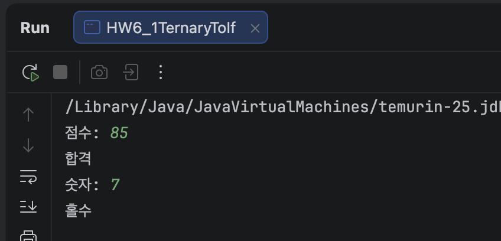
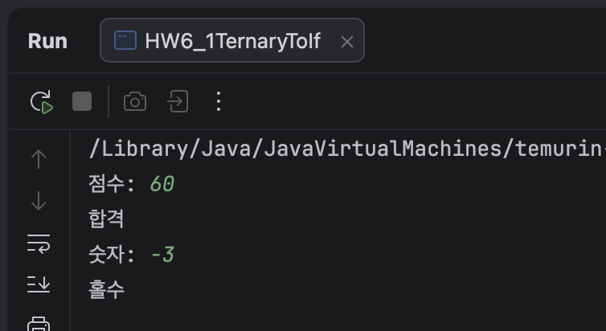
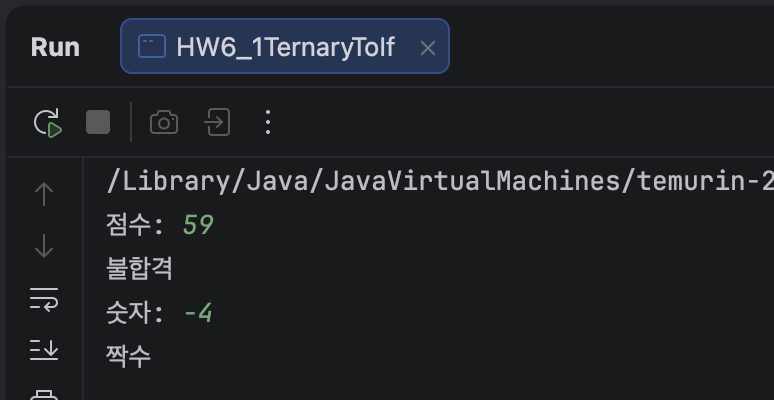
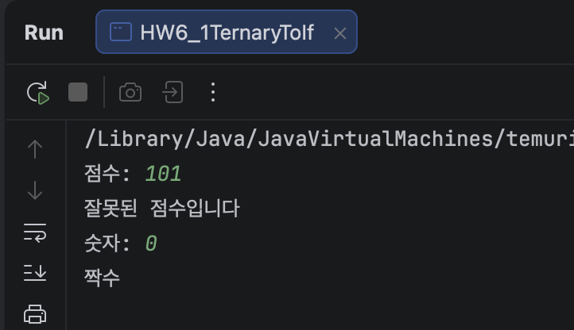
***

### 6-2. 학점 — 순서가 답을 바꾼다
점수를 입력받아 A(90~) B(80~) C(70~) D(60~) F 를 출력하세요.   
0 보다 작거나 100 보다 크면 "잘못된 점수입니다" 를 먼저 거르세요.   
 
**조건 1: 100, 90, 89, 60, 0, 101, -1 을 넣고 결과를 적을 것**   

**조건 2: 다 되면, else if 순서를 거꾸로 뒤집어서 돌려보세요.**   
```java
if (score >= 60) { ... D ... }
else if (score >= 70) { ... C ... }
else if (score >= 80) { ... B ... }
else if (score >= 90) { ... A ... }
```
**→ 뒤집은 상태에서 95 를 넣으면 뭐가 나올까요. 예상부터 적고 돌리세요.**   
예상: D
**→ 왜 그런지 한 줄로.**   
처음 부터 (score >= 60) 조건을 만족하기 때문에

**→ 뒤집은 상태에서 A 가 나오는 점수가 있나요?**   
없음

※ 이건 오류가 안 납니다. 컴파일도 되고 실행도 됩니다. 답만 틀립니다.   
3주차 84, 5주차 `[] 20` 이랑 같은 종류입니다.

#### - 예상
```
점수: 95
D
```

#### - 실행 결과 (정상 순서)
```
점수: 100
A

점수: 90
A

점수: 89
B

점수: 60
D

점수: 0
F

점수: 101
잘못된 점수입니다

점수: -1
잘못된 점수입니다

```
#### - 실행 결과 (뒤집은 순서)
```
점수: 95
D

점수: 100
D

점수: 90
D

점수: 89
D

점수: 60
D

점수: 0
F

점수: 101
잘못된 점수입니다

점수: -1
잘못된 점수입니다

```
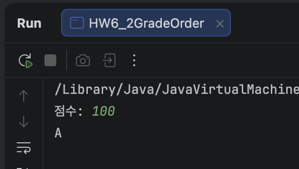         
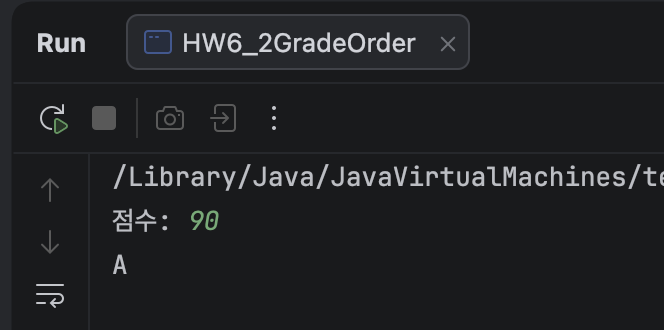      
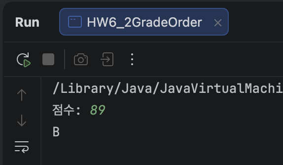      
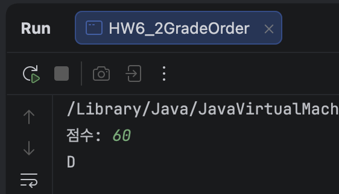   
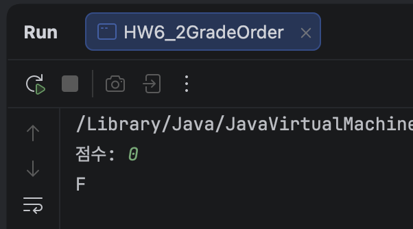      
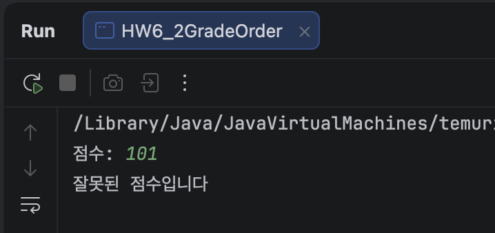   
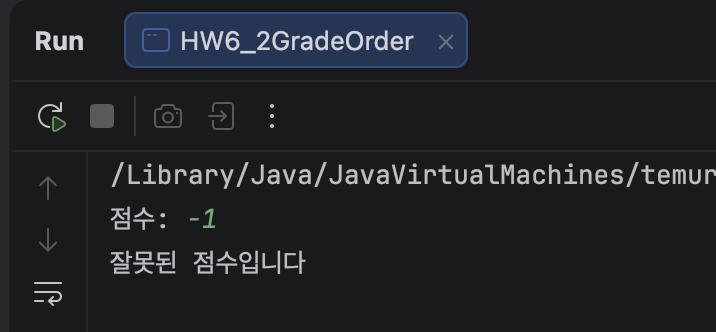      
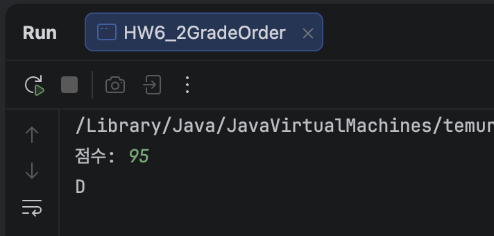   
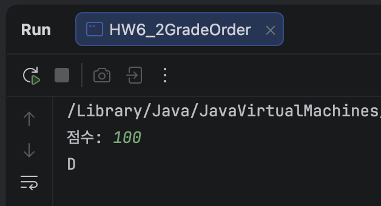      
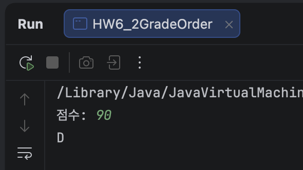   
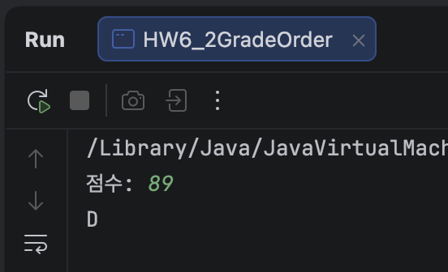   
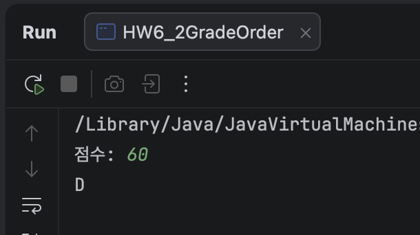   
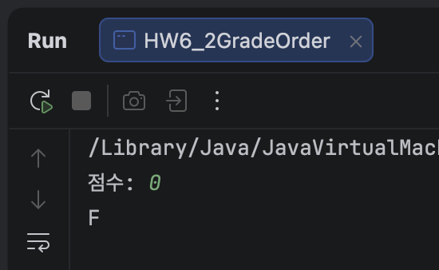   
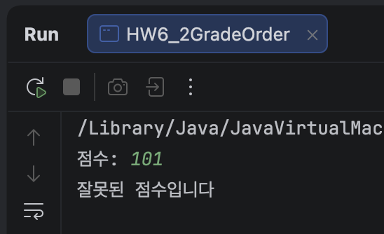   
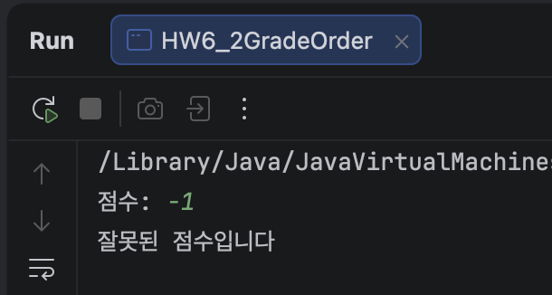   
***

### 6-3. 중괄호를 빼면
아래를 그대로 쳐서 돌리세요. 들여쓰기도 그대로.
```java
int score = 59;
if (score >= 60)
    System.out.println("합격");
    System.out.println("축하합니다");
```
**→ 59 인데 뭐가 출력되나요. 예상부터 적고 돌리세요.**  
축하합니다

**→ 왜 그런지 한 줄로.**     
중괄호가 없으면 if는 바로 다음 한 줄까지만 포함하고 축하합니다는 if와 무관하게 항상 실행 됨   

**→ 그 다음 Ctrl + Alt + L (맥은 Cmd + Option + L) 을 눌러보세요. 코드 모양이 어떻게 바뀌나요. 그게 무슨 뜻인지 한 줄로.**   
들여쓰기는 사람이 보기 편하기 위해 있는 것   
컴퓨터는 중괄호가 없으니 if 다음 한 줄만 포함하고 그 외는 다시 정렬함   

```java
    int score = 59;
    if (score >= 60)
        System.out.println("합격");
    System.out.println("축하합니다"); 
```

※ 3주차부터 커밋 전에 누르라고 한 그 단축키입니다.   
이번 주엔 줄 맞추기 말고 다른 걸 보여줍니다.

#### - 예상
```
축하합니다
```
#### - 실행 결과
```
축하합니다
```
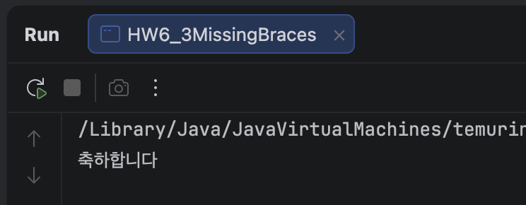   
***

### 6-4. 한 글자 실수 세 개
아래 세 개를 각각 넣어서 돌리세요. (score 는 59 로)
```java
// ①
if (score >= 60); {
    System.out.println("합격");
}

// ②
if (score = 60) {
    System.out.println("60점");
}

// ③
if (score >= 90) {
    System.out.println("A");
} elseif (score >= 80) {
    System.out.println("B");
}
```
**→ 오류가 나는 건 메시지 그대로 + 줄 번호까지. 안 나는 건 뭐가 출력됐는지.**   


**→ ② 의 메시지에 boolean 이라는 단어가 나옵니다.    
4주차 4-1 에서 "비교 결과는 무슨 자료형인가요" 물었었죠. 그거랑 이어서 한 줄로.**   
비교 결과는 boolean.   
비교 연산자 == 대신 대입 연산자 = 를 썼음.   
int는 60이 되고 if는 boolean만 판단 할 수 있어 컴파일 오류 발생.    

**→ ③ 의 메시지는 진짜 원인(elseif 붙여 씀)을 말해주나요? 1주차 세미콜론, 2주차 'abc' 때 한 얘기랑 이어서 한 줄로.**   
진짜 원일을 알려주지 않음.   
elseif를 하나의 메서드나 변수로 읽으려고 하는데 없어서 오류 발생.   

※ 세 개를 아래 표의 어디에 넣을지 정해서 적으세요. 이건 질문입니다. 참고 아닙니다. ㅎㅎ   

| 분류              | 예시 1            | 예시 2          | ①②③  |
|-------------------|-------------------|-----------------|------|
| 컴파일 오류       | 4-5 `int x = 3.7` | 5-1 import 빼기 | ② ③  |
| 실행 오류         | 3-5 `10 / 0`      | 5-4 abc         |      |
| 오류 없이 틀린 답 | 3-2 84            | 5-2 `[] 20`     | ①    |

#### - 실행 결과
```java
// ①
if (score >= 60); {
    System.out.println("합격");
}
// 합격 

// ②
if (score = 60) {
    System.out.println("60점");
}
// HW6_4SyntaxTypos.java:14
// incompatible types: int cannot be converted to boolean
        
// ③
if (score >= 90) {
    System.out.println("A");
} elseif (score >= 80) {
    System.out.println("B");
}
// HW6_4SyntaxTypos.java:22
// java: ';' expected

```
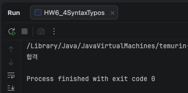   
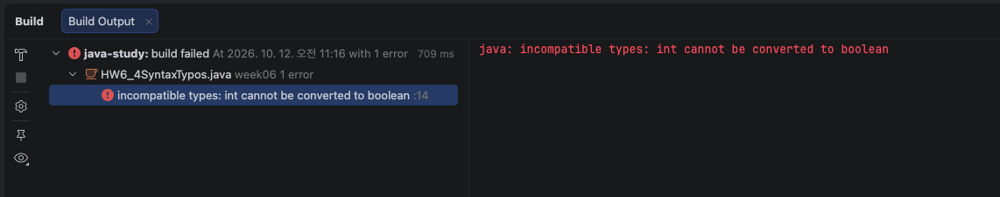   
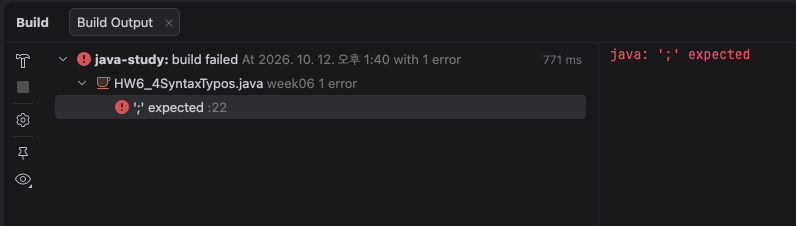   
***

### 6-5. 세 수 중 가장 큰 수
세 수를 입력받아 가장 큰 수를 출력하세요.

**조건 1: if 만 쓸 것. Math.max 같은 건 쓰지 마세요.**   

**조건 2: 아래 다섯 개를 전부 넣어서 결과를 적을 것.**   
```text
    3 7 5      7 7 3      5 5 5      3 9 9      -1 -2 -3
```

**조건 3: 다섯 개 중에 아무것도 안 나오거나 틀린 게 있으면 왜 그런지 적고 고칠 것.**   
if (b > max)를 만족 하면 else if (c > max)를 건너 뛰는 케이스가 발생   
1 2 3 같은 경우 가장 큰 수로 2가 출력 됨 
```java
    // 수정 전
    if (b > max) {
        max = b;
    } else if (c > max) {
        max = c;
    }
    
    // 수정 후
    if (b > max) {
        max = b;
    }
    if (c > max) {
        max = c;
    }
```

※ 3 7 5 하나만 넣고 "된다" 하면 안 됩니다.   
같은 수가 두 개 있을 때, 전부 음수일 때가 함정입니다.   
지난주 도전3 에서 1808000 넣어서 0장을 본 것처럼, 일부러 이상한 값을 넣어보는 겁니다.

#### - 실행 결과
```
세 수: 3 7 5
가장 큰 수: 7

세 수: 7 7 3
가장 큰 수: 7

세 수: 5 5 5
가장 큰 수: 5

세 수: 3 9 9
가장 큰 수: 9

세 수: -1 -2 -3
가장 큰 수: -1

```
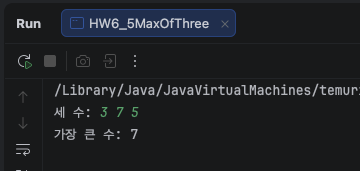   
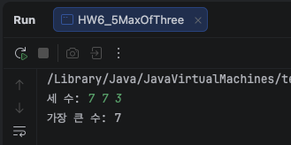   
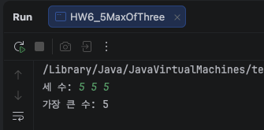   
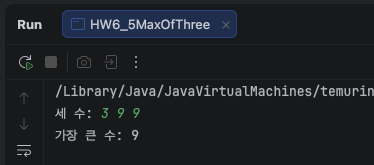   
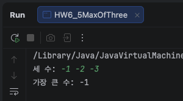   
***

### 6-6. 터지기 전에 막기
5-4 에서 나이에 abc 를 넣으면 터졌죠.   
Scanner 에는 "다음 입력이 정수냐" 를 미리 물어보는 게 있습니다.
```java
System.out.print("나이: ");
if (sc.hasNextInt()) {
    int age = sc.nextInt();
    System.out.println(age + "살");
} else {
    System.out.println("숫자를 입력하세요");
}
```
**→ 20, abc, 20.5 를 넣어서 결과를 적으세요. 20.5 는 예상부터.**   

**→ sc.hasNextInt() 가 돌려주는 건 무슨 자료형인가요. 한 줄로. (4-1 다시)**   
입력값이 int일 경우만 true를 반환

**→ 그 다음, if · else 가 끝난 아래에 이 줄을 추가해서 돌려보세요.**   

```java
System.out.println("입력한 나이: " + age);
```
**오류 메시지를 그대로 + 줄 번호까지 적고, 왜 그런지 한 줄로.  
{ } 안에서 만든 변수는 { }안에서만 유효함

힌트: age 는 어느 { } 안에서 만들어졌나요.**  

```java
    if (sc.hasNextInt()) { 
      int age = sc.nextInt();
      System.out.println(age + "살");
    }
```

**※ 이번엔 abc 를 넣어도 안 터집니다.   
이건 컴파일러가 막아준 겁니까, 작성자가 직접 막은 겁니까. 한 줄로.      
"컴파일러는 코드를 보고, 예외는 값을 본다" — 그럼 값은 누가 봐야 하나요.**
코드 작성자가 hasNextInt()로 미리 막은 것.   
컴파일러는 사용자가 뭘 입력할지 미리 알 수 없어서 못 막아주기 때문에 작성자가 직접 확인해야함

#### - 실행 결과
```
나이: 20
20살

나이: abc
숫자를 입력하세요

나이: 20.5 
숫자를 입력하세요 // 예상
숫자를 입력하세요

```
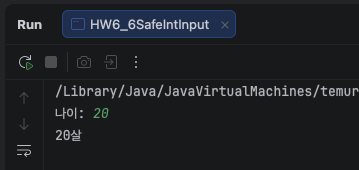   
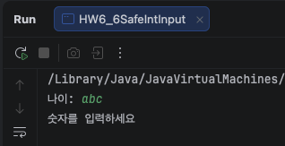   
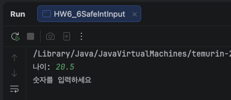   
***

#### - 오류 메시지
```
HW6_6SafeIntInput.java:17
java: cannot find symbol
  symbol:   variable age
  location: class week06.HW6_6SafeIntInput
```
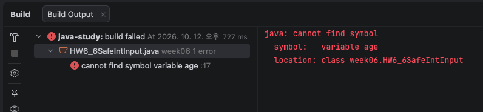

## 도전 과제
### 도전 1. 계산기 다시
5주차 도전2 를 if · else if 로 다시 쓰세요.
```text
    첫 번째 수: 10
    연산자 (+ - * /): /
    두 번째 수: 4
    10 / 4 = 2.5
```
**조건 1: 나눗셈은 2.5 가 나올 것. (double) 위치를 README 에 한 줄로 적을 것.**   
/분기 안에서 나누기 직전 result = (double) firstNumber / secondNumber;처럼 첫 번째 수 앞에 둠.

**조건 2: 0 으로 나누면 터지지 말고 "0 으로 나눌 수 없습니다" 를 출력할 것.**   

**조건 3: + - * / 가 아닌 걸 넣으면 "지원하지 않는 연산자입니다" 를 출력할 것. % 랑 x 를 넣어서 확인하세요. 지난주 코드에서는 둘 다 나눗셈이 됐습니다.**   

**조건 4: 10 + 4, 10 / 4, 10 / 0, 10 % 4 네 개를 돌리고 결과를 적을 것.**

**→ 지난주 삼항이랑 이번 if 중에 어느 쪽이 읽기 쉬운지 한 줄로.**   
"삼항은 10주차 가면 if 로 다시 쓴다" 고 했던 그 비교를 지금 합니다.

※ 조건 2 는 / 일 때만 필요합니다. if 안에 if 가 들어갑니다. (중첩 if)

#### - 실행 결과
```
    첫 번째 수: 10
    연산자 (+ - * /): /
    두 번째 수: 4
    10 / 4 = 2.5
    
    첫 번째 수: 10
    연산자 (+ - * /): /
    두 번째 수: 0
    0 으로 나눌 수 없습니다
    
    첫 번째 수: 10
    연산자 (+ - * /): (
    두 번째 수: 5
    지원하지 않는 연산자입니다

    ============================
    
    첫 번째 수: 10
    연산자 (+ - * /): +
    두 번째 수: 4
    10 + 4 = 14.0
    
    첫 번째 수: 10
    연산자 (+ - * /): /
    두 번째 수: 4
    10 / 4 = 2.5
    
    첫 번째 수: 10
    연산자 (+ - * /): /
    두 번째 수: 0
    0 으로 나눌 수 없습니다
    
    첫 번째 수: 10
    연산자 (+ - * /): %
    두 번째 수: 4
    지원하지 않는 연산자입니다

```
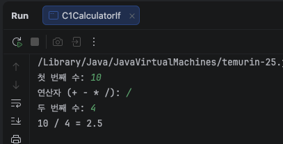   
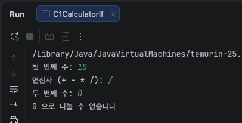   
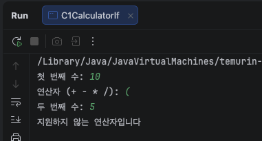     
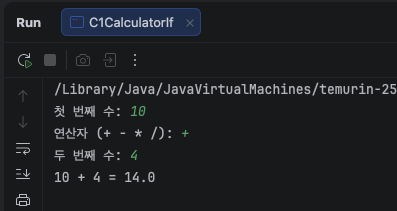      
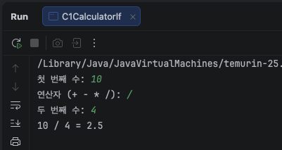      
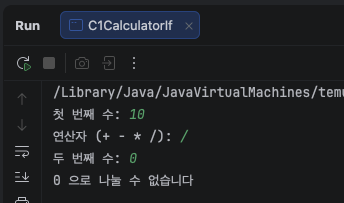   
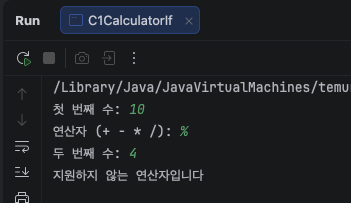   
***

### 도전 2. 윤년을 if 로
4·5주차에는 한 줄 식으로 했죠.
```java
    (year % 4 == 0 && year % 100 != 0) || year % 400 == 0
```
이번엔 규칙을 if · else if 로 그대로 옮기세요.   
결과는 boolean isLeapYear 에 담고, 마지막에 한 번만 출력합니다.

**조건 1: 1900, 2000, 2024, 2023, 2100 다섯 개를 넣고 결과를 적을 것.**   

#### - 실행 결과
```
    연도입력: 1900
    1900년 윤년 아님 X
    
    연도입력: 2000
    2000년 윤년 O
    
    연도입력: 2024
    2024년 윤년 O
    
    연도입력: 2023
    2023년 윤년 아님 X
    
    연도입력: 2100
    2100년 윤년 아님 X

```
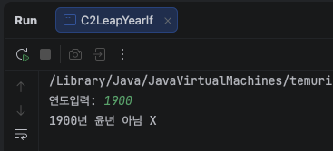   
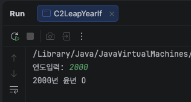   
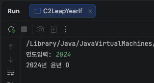   
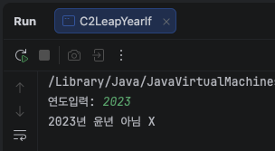   
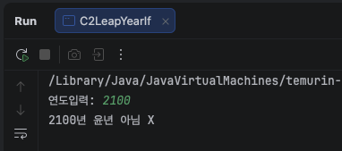   

**조건 2: 같은 다섯 개를 지난주 한 줄 식에도 넣어서 결과가 같은지 비교할 것.**   
if버전과 한줄식을 각각 다른 변수(isLeapYear, isLeapYearOneLiner)에 담아서 같이 출력    
결과가 일치함.    

#### - 실행 결과
```
    연도입력: 1900
    1900년 윤년 아님 X
    1900년 한줄식: 윤년 아님 X
    
    연도입력: 2000
    2000년 윤년 O
    2000년 한줄식: 윤년 O
    
    연도입력: 2024
    2024년 윤년 O
    2024년 한줄식: 윤년 O
    
    연도입력: 2023
    2023년 윤년 아님 X
    2023년 한줄식: 윤년 아님 X
    
    연도입력: 2100
    2100년 윤년 아님 X
    2100년 한줄식: 윤년 아님 X

```
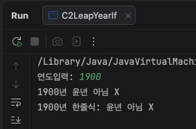   
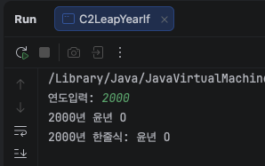   
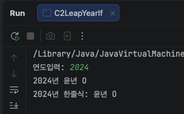   
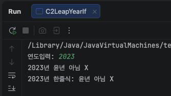   
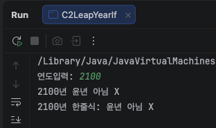   

**조건 3: 다 되면 if 순서를 4 → 100 → 400 으로 바꿔보세요. (첫 번째 if 가 `year % 4 == 0`)    
결과가 달라지는 연도가 있나요.    
있으면 왜 그런지 한 줄로.**   

1900, 2100 은 윤년 아님인데 윤년으로 나옴.   
year % 4 == 0 조건에 해당하기 때문에 다른 조건 검토없이 true 로 확정.

```
    연도입력: 1900
    1900년 윤년 O → 정답: 윤년 아님 X
    
    연도입력: 2000
    2000년 윤년 O
    
    연도입력: 2024
    2024년 윤년 O
    
    연도입력: 2023
    2023년 윤년 아님 X
    
    연도입력: 2100
    2100년 윤년 O → 정답: 윤년 아님 X
```

※ 6-2 학점이랑 같은 얘기입니다. 좁은 조건부터 넓은 조건 순. 이번엔 뭐가 제일 좁은지 진경이가 정해야 합니다.
***

### 도전 3. 가위바위보
1 가위, 2 바위, 3 보 로 하고, 컴퓨터는 고정값으로 둡니다.
```java
final int COMPUTER = 2;     // 맨 윗줄. 바위
```
```text
가위(1) 바위(2) 보(3) 중 하나: 3
컴퓨터: 2
이겼습니다
```
**조건 1: 1, 2, 3, 그리고 5 를 넣어서 결과를 적을 것. 5 는 "잘못된 입력입니다".**   
#### - 실행 결과
```
가위(1) 바위(2) 보(3) 중 하나: 1
컴퓨터: 2
졌습니다

가위(1) 바위(2) 보(3) 중 하나: 2
컴퓨터: 2
비겼습니다

가위(1) 바위(2) 보(3) 중 하나: 3
컴퓨터: 2
이겼습니다

가위(1) 바위(2) 보(3) 중 하나: 5
잘못된 입력입니다
```
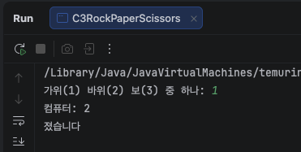   
   
   
   

**조건 2: COMPUTER 를 1 과 3 으로도 바꿔서 돌려볼 것. 맨 윗줄만 고칩니다.**   
#### - 실행 결과
```
COMPUTER = 1 (가위)

가위(1) 바위(2) 보(3) 중 하나: 1
컴퓨터: 1
비겼습니다

가위(1) 바위(2) 보(3) 중 하나: 2
컴퓨터: 1
이겼습니다

가위(1) 바위(2) 보(3) 중 하나: 3
컴퓨터: 1
졌습니다

COMPUTER = 3 (보)

가위(1) 바위(2) 보(3) 중 하나: 1
컴퓨터: 3
이겼습니다

가위(1) 바위(2) 보(3) 중 하나: 2
컴퓨터: 3
졌습니다

가위(1) 바위(2) 보(3) 중 하나: 3
컴퓨터: 3
비겼습니다
```
   
   
   
   
   
   

**조건 3: 문자열("가위") 로 받지 말고 숫자로 받을 것.    
문자열 비교는 14주차입니다. == 로 하면 안 되는 이유가 거기 나옵니다.**   

한 단계 더 가고 싶으면.   
이기고 지는 경우를 if 로 다 쓰면 조건이 꽤 많아집니다. 3주차 % 를 쓰면 확 줄어듭니다.
```java
int r = (user - COMPUTER + 3) % 3;
```
**r 이 0, 1, 2 일 때 각각 무슨 뜻인지 찾아서 적으세요.   
그리고 + 3 을 빼면 왜 안 되는지 한 줄로. 6-1 의 `-3 % 2` 랑 이어집니다.**
→ r == 0 비김, r == 1 user 승, r == 2 user 패.   
+3 을 빼면 user - COMPUTER 가 음수일 때 Java가 0 쪽으로 버려서 음수 나머지(-1, -2)가 나와 0/1/2 매핑이 깨짐 — 6-1 의 `-3 % 2` 와 같은 이유.

***

## 힌트

if 는 세 모양입니다.
```java
if (조건) {                   // 조건이 true 일 때만
    ...
}

if (조건) {                   // 둘 중 하나는 반드시
    ...
} else {
    ...
}

if (조건1) {                  // 위에서부터 차례로. 처음 맞는 거 하나만 실행
    ...
} else if (조건2) {
    ...
} else {                      // 위에 다 아니면
    ...
}
```
( ) 안에는 boolean 만 들어갑니다.      
4주차에 만든 비교식, `&&` `||`, isLeapYear 같은 boolean 변수가 전부 여기 들어갑니다.      
4주차가 이번 주 준비였던 겁니다.   

else if 는 위에서부터 봅니다. 맞는 걸 하나 찾으면 나머지는 안 봅니다.      
그래서 좁은 조건부터 넓은 조건 순으로 씁니다.     
순서를 정하기 어려우면 종이에 수직선을 그려보세요.   
```text
0 ─── 60 ─── 70 ─── 80 ─── 90 ─── 100
   F     D      C      B      A
```

중괄호는 한 줄이어도 씁니다.   
들여쓰기는 사람만 보는 겁니다. 자바는 안 봅니다.   
{ } 가 없으면 if 는 바로 다음 한 줄만 자기 걸로 칩니다.   
6-3 에서 직접 보세요.

= 와 == 다시.
```text
3주차    = 는 넣어라
4주차    == 는 같냐고 묻는 것
이번 주  if ( ) 안에는 묻는 게 들어간다. 그래서 == 다.
```

{ } 안에서 만든 변수는 { } 밖에서 안 보입니다.   
밖에서도 써야 하면 { } 밖에서 먼저 만들어두세요.
```java
boolean isLeapYear;           // 밖에서 만들고
if (...) {
    isLeapYear = true;        // 안에서 넣는다
} else {
    isLeapYear = false;
}
System.out.println(isLeapYear);
```
도전2 가 이 모양입니다.

가장 큰 수는 "지금까지 제일 큰 것" 을 들고 다니는 겁니다.
```java
int max = a;
if (b > max) {
    max = b;
}
...
```
2주차 "= 는 넣어라", 3주차 "원래 값을 따로 둔다" 가 여기서 같이 쓰입니다.   
다른 방법으로 풀어도 됩니다. 대신 6-5 다섯 개를 전부 통과해야 합니다.

지난주에 얘기한 것 이어서

☑ 5주차 도전2 계산기 — (double) 붙인 버전으로 다시 커밋   
 터지는 버전은 주석 + 메시지로 남기고, (double) 위치는 README 에 한 줄   
☑ 5-5 83.39999999999999 가 왜 나왔는지 한 줄 (4-6 0.1 + 0.2 랑 같은 이유)   
☑ 5-3 nextLine 앞에 공백이 왜 붙었는지 한 줄 (5-2 엔터 남는 거랑 같은 규칙)   
☑ HW5_2 의 sc.nextLine(); 에 주석, HW5_6 에 nextChar() 실험 줄 주석 + 메시지   
☑ 5주차 도전3 README "100 미만" → "500 미만"   
☑ at 줄이 여러 개면 위에서부터 내려가다 처음 나오는 내 파일 줄 (IntelliJ 파란 링크)   
☑ README 결과는 저장소 코드로 다시 돌려도 똑같이 나와야 한다   
 커밋 직전에 그 코드로 한 번 더 돌려보기   
☑ 커밋 전 Ctrl + Alt + L (공백 두 칸 두 군데 있었습니다)   
☑ 안 물어본 데서도 "어? 이거 이상한데?" — 83.39999999999999 같은 것

## 제출 전 확인
- [x] if 마다 중괄호 { } 를 썼는가 (한 줄이어도)
- [x] if ( ) 안에 = 가 아니라 == 를 썼는가
- [x] 6-1 -3 을 넣어보고 홀수 조건을 고쳤는가
- [x] 6-2, 6-3, 6-6, 도전1 예상을 돌리기 전에 적었는가
- [x] 6-2 경계값 (100 90 89 60 0 101 -1) 을 전부 넣어봤는가
- [x] 6-4 세 개를 표의 어디에 넣을지 적었는가 (※ 줄도 질문입니다)
- [x] 6-5 다섯 개를 전부 통과하는가
- [x] 6-6 abc 를 넣어도 안 터지는가
- [x] 도전1 % 와 x 를 넣으면 "지원하지 않는 연산자입니다" 가 나오는가
- [x] 도전2 if 버전과 한 줄 식의 결과가 다섯 개 다 같은가
- [x] README 결과가 저장소 코드로 돌린 결과와 같은가
- [x] 5주차 도전2 를 (double) 버전으로 다시 올렸는가
***