# Week 07 조건문 switch

## 학습 기간
2026-10-12 ~ 2026-10-19
***

지난주 if 로 "이 값이면 이 줄, 아니면 저 줄" 을 골랐다.   
이번 주는 고르는 방법이 하나 더 생긴다.

if 는 "점수가 90 이상이냐" 처럼 범위를 묻고,
switch 는 "월이 3 이냐" 처럼 딱 맞는 값을 찾는다.

지난주 계산기를 if · else if 로 길게 썼다.
이번 주에 그걸 switch 로 다시 쓰면 얼마나 짧아지는지 본다.
대신 switch 에는 if 에 없는 함정이 하나 있다. break.

## 과제 내용
### 7-1. 월별 일수
월을 입력받아 그 달의 일수를 출력하세요. (2월은 28일)
```text
월: 4
30일
```
**조건 1: 전통 방식(case 1: ... break;)으로 쓸 것**   

**조건 2: 31일인 달은 case 를 하나씩 따로 쓰지 말고 묶을 것**   

```java
case 1:
case 3:
...
    System.out.println("31일");
    break;
```
**조건 3: 2, 4, 7, 12, 13, 0 을 넣고 결과를 적을 것**
#### - 실행 결과
```
    월: 2
    28일
    
    월: 4
    30일
    
    월: 7
    31일
    
    월: 12
    31일
    
    월: 13
    28일
    
    월: 0
    28일
```
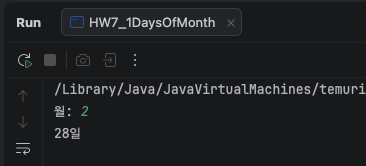   
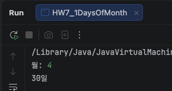   
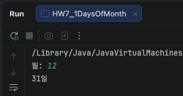   
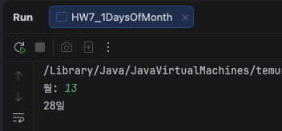   
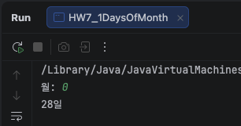     

**→ 13 이랑 0 은 뭐가 나왔나요.  default 를 안 넣었으면 아무것도 안 나옵니다.**  
13 이랑 0 은 뭐가 나왔나요 → 2월이 default로 처리 하게해서 28이 나왔었음

**default 넣어서 "잘못된 월입니다" 가 나오게 고치세요.**   
#### - 실행 결과
```
월: 13
잘못된 월입니다

월: 0
잘못된 월입니다
```
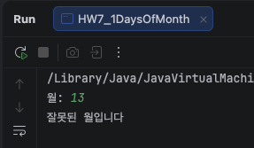   
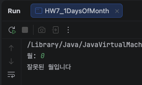   

**→ 6주차 도전2 윤년 식을 가져와서 2월이 29일이 되게 해보세요. 연도도 입력받습니다.   
2024 2월, 2023 2월, 1900 2월 세 개. switch 안에 if 가 들어갑니다.**
현재 윤년 판별 식은 주석 처리 해둠     

#### - 실행 결과
```
    연도입력: 2024 
    월: 2
    29일
    
    연도입력: 2023
    월: 2
    28일
    
    연도입력: 1900
    월: 2
    28일
```
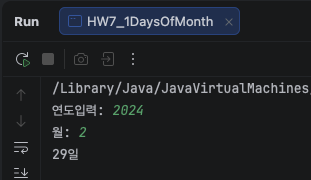   
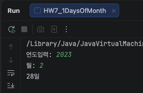
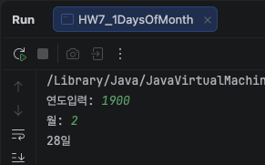
***

### 7-2. break 를 빼면
아래를 그대로 쳐서 돌리세요.
```java
int day = 2;
switch (day) {
    case 1:
        System.out.println("월");
    case 2:
        System.out.println("화");
    case 3:
        System.out.println("수");
    default:
        System.out.println("모름");
}
```
**→ day 가 2 인데 뭐가 출력되나요. 예상부터 적고 돌리세요.**  
```
    예상
    화
    
    결과        
    화
    수
    모름
```

**→ 왜 그런지 한 줄로.**   
case 1에 해당하지 않아 결과는 출력되지 않았는데 case 2 에 해당 하고 3, default 까지 출력됨

**→ day 를 1, 3, 9 로 바꿔서 각각 몇 줄 나오는지 적으세요.**
```
    4줄 
    int day = 1;
    월
    화
    수
    모름
    
    2줄
    int day = 3;
    수
    모름
    
    1줄
    int day = 9;
    모름
```

※ 이것도 오류가 안 납니다. 6주차 표에서 어디에 들어갈지 적으세요.   

| 분류               | 예시 1            | 예시 2          |
|--------------------|-------------------|-----------------|
| 컴파일 오류        | 4-5 `int x = 3.7` | 6-4 ③ elseif    |
| 실행 오류          | 3-5 `10 / 0`      | 5-4 abc         |
| 오류 없이 틀린 답  | 3-2 84            | 6-2 순서 뒤집기 |

오류 없이 틀린 답에 해당함   

**※ 7-1 조건 2 에서 31일 달을 묶은 것도 사실 break 가 없어서 되는 겁니다.   
같은 성질인데 7-1 은 일부러 쓴 거고 7-2 는 실수입니다. 차이를 한 줄로.**   
7-1은 중간에 실행될 코드가 없는 묶음이고 7-2는 break 가 없어서 다음 case의 출력문까지 실행되는 실수임   
***

### 7-3. 계산기를 switch 로
6주차 도전1 계산기를 switch 로 다시 쓰세요.   
연산자는 6주차처럼 받으세요.
```text
첫 번째 수: 10
연산자 (+ - * /): /
두 번째 수: 4
10 / 4 = 2.5
```
**조건 1: 6주차와 결과가 똑같을 것. `10 + 4`, `10 / 4`, `10 / 0`, `10 % 4` 네 개.**   
```
    첫 번째 수: 10
    연산자 (+ - * /): +
    두 번째 수: 4
    10 + 4 = 14.0
    
    첫 번째 수: 10
    연산자 (+ - * /): /
    두 번째 수: 4
    10 / 4 = 2.5
    
    첫 번째 수: 10
    연산자 (+ - * /): /
    두 번째 수: 0
    0 으로 나눌 수 없습니다
    
    첫 번째 수: 10
    연산자 (+ - * /): %
    두 번째 수: 4
    지원하지 않는 연산자입니다
```
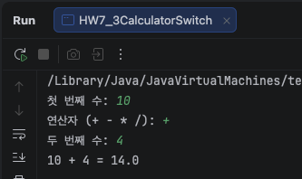   
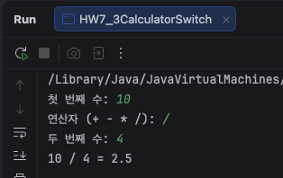   
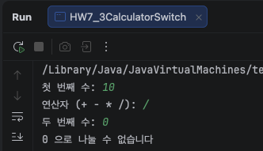   
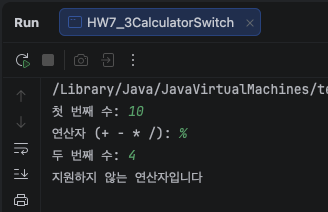   

**조건 2: 0 으로 나누기, 지원하지 않는 연산자 처리도 그대로.**

```
    첫 번째 수: 10
    연산자 (+ - * /): /
    두 번째 수: 0
    0 으로 나눌 수 없습니다
    
    첫 번째 수: 10
    연산자 (+ - * /): %
    두 번째 수: 4
    지원하지 않는 연산자입니다
```
   
   

**→ 연산자를 char 로 받았으면 case '+' 를, String 으로 받았으면 case "+" 를 씁니다.   
일부러 반대로 바꿔서 돌려보세요.    
오류 메시지 그대로 + 줄 번호. 4주차 4-1 "무슨 자료형인가요" 랑 이어서 한 줄로.**   

'+'는 char, "+"는 String으로 문법상 타입이 아예 다름   
switch 의 case 는 switch 식과 똑같은 타입이어야 하는데 안 맞아서 컴파일 오류 발생

#### - 오류 메시지
```
    HW7_3CalculatorSwitch.java:23, 26, 29, 32
      java: incompatible types: char cannot be converted to java.lang.String
      java: incompatible types: char cannot be converted to java.lang.String
      java: incompatible types: char cannot be converted to java.lang.String
      java: incompatible types: char cannot be converted to java.lang.String
```

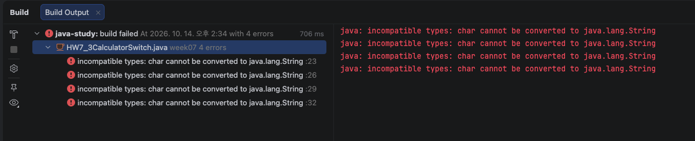

**→ 6주차 if 버전이랑 줄 수를 세서 적으세요. 어느 쪽이 읽기 쉬운지 한 줄로.**
6주차 if 버전: 전체  44줄, 분기문 16줄   
7주차 switch 버전: 전체 48줄, 분기문 21줄   

7-3, 6주차 도전 1과제와 비교했을 때 switch가 더 잘 읽히는 것 같음   
case 조건이 간단하고 각 줄에 표현되는 코드가 단순해서 잘 읽힘
***

### 7-4. 학점을 switch 로 — 될까
6주차 6-2 학점을 switch 로 바꿔보세요.

먼저 이렇게 써보세요.
```java
switch (score) {
    case score >= 90:
        ...
```
**→ 오류 메시지 그대로. 왜 안 되는지 한 줄로.**   
case는 boolean이 아니라 switch 식과 같은 타입의 값 하나만 들어가야 하는데 score >= 90은 boolean 이라서 안 됨.

#### - 오류 메시지
```
    HW7_4GradeSwitch.java: 15, 18, 21, 24, 27
      java: incompatible types: boolean cannot be converted to int
      java: incompatible types: boolean cannot be converted to int
      java: incompatible types: boolean cannot be converted to int
      java: incompatible types: boolean cannot be converted to int
      java: incompatible types: boolean cannot be converted to int
```

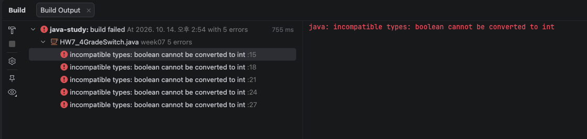

그 다음 이렇게 바꾸세요.
```java
switch (score / 10) {
    case 10:
    case 9:
        System.out.println("A");
        break;
    ...
```
**조건: 100, 90, 89, 60, 0, 101, -1, -5 를 넣고 결과를 적을 것**   
```
    점수: 100
    A
    
    점수: 90
    A
    
    점수: 89
    B
    
    점수: 60
    D
    
    점수: 0
    F
    
    점수: 101
    A
    
    점수: -1
    F
    
    점수: -5
    F

``` 
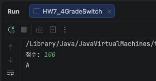   
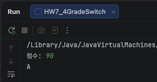   
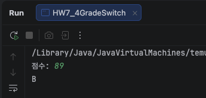   
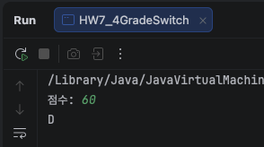     
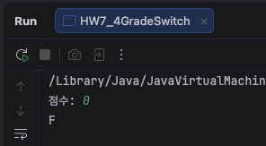   
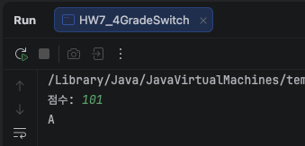   
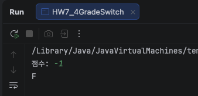   
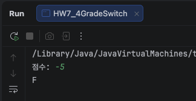   

**→ 101 이랑 -5 는 뭐가 나왔나요. 예상부터.    
힌트: 101 / 10 은 얼마죠. -5 / 10 은요. (6주차 -3 % 2 랑 같은 이야기, 0 쪽으로 자른다)**
```
    - 101 / 10 = 10 (10.1) → A
    - 5 / 10 = 0 (-0.5) → F
```

**→ 6-2 에서 "잘못된 점수입니다" 를 먼저 거른 게 여기서도 필요한가요. 한 줄로.**
위 케이스와 같은 경우 잘못된 점수를 걸러내지 못해 필요함   
HW7_4GradeSwitch.java에는 관련 코드 주석 처리 되어 있음
활성화시 101, -5 잘못된 점수입니다로 나옴

**※ 학점은 switch 랑 if 중에 어느 게 맞는 도구인지 한 줄로. 커리큘럼 표에 정답이 있습니다. 찾지 말고 먼저 적으세요. ㅎㅎ**
switch는 범위 비교 불가. if 사용
***

### 7-5. 새 문법 -> 로 바꾸기
7-1 월별 일수를 새 switch 표현식으로 다시 쓰세요.
```java
int days = switch (month) {
    case 1, 3, 5, 7, 8, 10, 12 -> 31;
    case 4, 6, 9, 11           -> 30;
    case 2                     -> 28;
    default                    -> 0;
};
```
**조건 1: 7-1 과 같은 값 여섯 개를 넣어 결과가 같은지 비교할 것**   
```
    월: 2
    28일
    
    월: 4
    30일
    
    월: 7
    31일
    
    월: 12
    31일
    
    월: 13
    잘못된 월입니다
    
    월: 0
    잘못된 월입니다

```

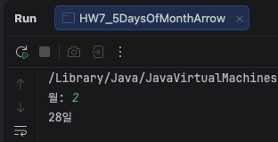  
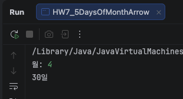  
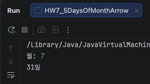  
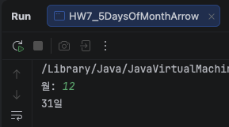  
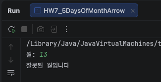  
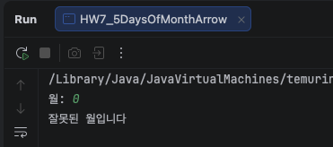  

**조건 2: default 줄을 지우고 돌려보세요. 오류 메시지 그대로 + 줄 번호.**   
#### - 오류 메시지
```
    HW7_5DaysOfMonthArrow.java:12
      the switch expression does not cover all possible input values
```

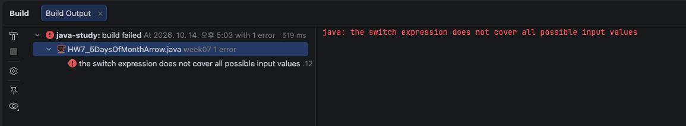

**→ 전통 방식에서는 default 를 빼도 오류가 안 났는데 여기서는 왜 나나요.    
한 줄로. 힌트: days 에 뭔가 꼭 들어가야 합니다. 13 을 넣으면 days 는 뭐가 되나요.**      
전통 방식은 조건이 안맞으면 계속내려가는데 새 방식은 switch의 결과가 days에 저장되기 때문에 반드시 값이 들어가야함.   
System.out.println("잘못된 월입니다");가 없는 상태에서 13을 넣으면 `0일`이 됨.   

**→ 7-2 처럼 break 를 빼먹는 실수가 여기서도 생길 수 있나요. 한 줄로.**   
아니오.    
새 방식에서는 다음 줄로 넘어간다는 개념이 없고 해당 하는 케이스를 만나면 거기서 끝.      
break 유무와 상관이 없음.   

※ 이번 주에 제일 중요한 문제입니다. 컴파일러가 막아주는 실수가 하나 늘었습니다. 4주차에 본 그거요.

## 도전 과제
### 도전 1. 계절
월을 입력받아 봄 / 여름 / 가을 / 겨울 을 출력하세요.

**조건 1: -> 로 쓸 것. case 3, 4, 5 -> 처럼 묶을 것**  

**조건 2: 12, 1, 2 가 같은 겨울로 나오는지 확인할 것**  
#### - 실행 결과
```
    월: 12
    겨울
    
    월: 1
    겨울
    
    월: 2
    겨울
```
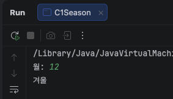
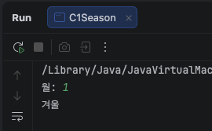
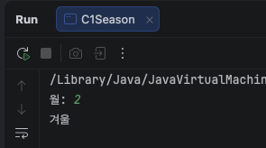

**조건 3: 13 을 넣으면 "잘못된 월입니다"**

**→ 결과를 String season 에 담고 마지막에 한 번만 출력하세요.    
6주차 도전2 isLeapYear 랑 같은 모양입니다.**

#### - 실행 결과
```
    월: 13
    잘못된 월입니다
```
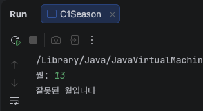
***

### 도전 2. 등급별 할인
회원 등급을 입력받아 할인율을 출력하세요.
```text
등급: GOLD
할인율: 10%
```
```text
BRONZE 3%   SILVER 5%   GOLD 10%   그 외 0%
```
**조건 1: 등급은 String 으로 받고 switch 표현식(->)으로 할 것**   

**조건 2: GOLD, SILVER, BRONZE, gold, PLATINUM 다섯 개를 넣어 결과를 적을 것**
#### - 실행 결과
```
    등급: GOLD
    할인율: 10%
    
    등급: SILVER
    할인율: 5%
    
    등급: BRONZE
    할인율: 3%
    
    등급: gold
    등록되지 않은 등급입니다 (할인율 0%) // 등록되지 않은 등급입니다 과제 내용 없는 조건 임의 추가

    등급: PLATINUM
    등록되지 않은 등급입니다 (할인율 0%) // 등록되지 않은 등급입니다 과제 내용 없는 조건 임의 추가
```
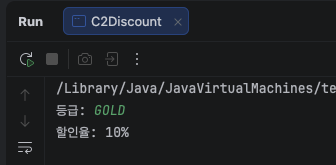   
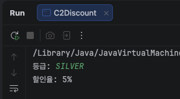   
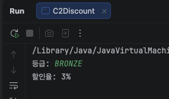   
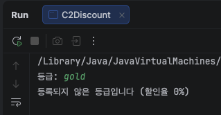   
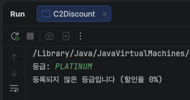    

**→ gold 는 뭐가 나왔나요. 왜 그런지 한 줄로.**
등록되지 않은 등급입니다 (할인율 0%)   
String은 대소문자 구분함    

**→ 6주차 도전3 에서 "문자열 비교는 14주차, == 로 하면 안 된다" 고 했었죠.    
그런데 switch 는 String 을 받아도 잘 됩니다. 14주차 가서 이유가 나옵니다.    
지금은 "switch 는 되더라" 만 적어두세요.**   
switch 는 String 을 받아도 된다.

※ 회사 등급 같은 건 원래 enum 이라는 걸 씁니다.    
한참 뒤에 나옵니다. 그때 이 문제를 다시 씁니다.
***

### 도전 3. 메뉴
아래 메뉴를 출력하고 번호를 입력받아 처리하세요.
```text
1. 입력  2. 조회  3. 삭제  0. 종료
선택: 2
조회를 선택했습니다
```
**조건 1: 1 2 3 0, 그리고 7 과 abc 를 넣어 결과를 적을 것**  
```
1. 입력  2. 조회  3. 삭제  0. 종료
선택: 1
입력를 선택했습니다

1. 입력  2. 조회  3. 삭제  0. 종료
선택: 2
조회를 선택했습니다

1. 입력  2. 조회  3. 삭제  0. 종료
선택: 3
삭제를 선택했습니다

1. 입력  2. 조회  3. 삭제  0. 종료
선택: 0
종료를 선택했습니다

1. 입력  2. 조회  3. 삭제  0. 종료
선택: 7
등록되지 않은 메뉴를 선택했습니다

1. 입력  2. 조회  3. 삭제  0. 종료
선택: abc
잘못된 입력입니다
```
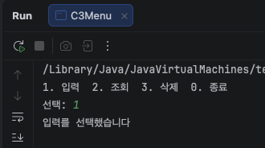  
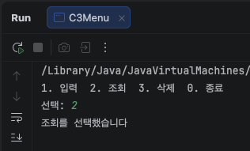
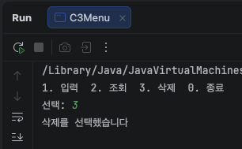
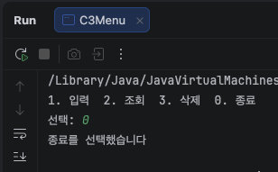
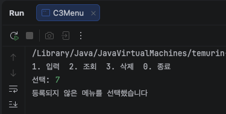
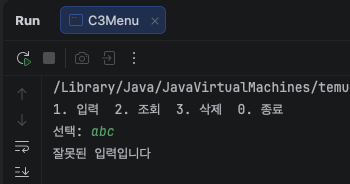

**조건 2: abc 를 넣어도 안 터질 것 (6주차 6-6 hasNextInt)**

**→ 지금은 한 번 고르면 프로그램이 끝납니다.   
0 을 누를 때까지 계속 메뉴가 나오게 하려면 뭐가 필요할까요.    
한 줄로. 다음 주(8주차 반복문)에 이 문제를 다시 씁니다. 파일 지우지 마세요.**
menu가 0이 될 때까지 같은 질문을 반복해서 물어보는 반복문이 필요함 

## 힌트


switch 는 두 모양입니다.
```text
전통 방식                            새 방식 (JDK 14+)

switch (값) {                        String r = switch (값) {
    case 1:                              case 1    -> "하나";
        ...                              case 2, 3 -> "둘셋";
        break;                           default   -> "모름";
    case 2:                          };
    case 3:
        ...
        break;
    default:
        ...
}
```

break 는 "여기서 switch 를 나가라" 입니다.   
없으면 아래 case 로 그냥 흘러갑니다. 오류도 안 납니다.   
맞는 case 를 찾으면 거기서부터 break 를 만날 때까지 전부 실행합니다.   
`->` 를 쓰면 흘러가지 않습니다. 그래서 새 방식을 권합니다.

case 에는 값만 들어갑니다.
```text
case 3:            된다
case 3, 4, 5 ->    된다
case score >= 90:  안 된다. 범위는 if 로.
```
그래서 학점은 `score / 10` 으로 값을 만들어서 넣는 겁니다.

switch 로 만든 값을 변수에 담으면 (`= switch ...`) 모든 경우를 다 덮어야 합니다.   
int 는 경우가 끝이 없으니 default 가 꼭 있어야 합니다. 7-5 조건 2 에서 직접 보세요.

if 와 switch 고르기
```text
범위, 여러 조건 섞기 (score >= 90 && ...)   if
값 하나가 정확히 뭐냐 (month == 3)           switch
```
둘 다 되는 문제도 있습니다. 그럴 땐 읽기 쉬운 쪽.

## 제출 전 확인
- [x] 전통 방식 case 마다 break 가 있는가 (일부러 뺀 곳은 주석)
- [x] default 를 넣었는가
- [x] 7-1, 7-5 결과 여섯 개가 같은가
- [x] 7-2, 7-4, 7-5 예상을 돌리기 전에 적었는가
- [x] 7-2 를 6주차 표의 어디에 넣을지 적었는가
- [x] 7-3 결과가 6주차 계산기와 네 개 다 같은가
- [x] 7-4 101 과 -5 를 넣어봤는가
- [x] 7-5 default 를 지웠을 때 메시지를 적었는가
- [x] 도전3 abc 를 넣어도 안 터지는가
- [x] README 결과가 저장소 코드로 돌린 결과와 같은가
- [x] 커밋 전 Ctrl + Alt + L
***