# Week 08 반복문 for

## 학습 기간
2026-10-19 ~ 2026-10-26
***

지금까지는 위에서 아래로 한 번씩만 내려갔다.   
if 랑 switch 는 "어느 줄로 가야할지"를 골랐고, 이번 주 for 는 "같은 줄을 몇 번 탈지"를 정하는 거다.

1주차에 별 다섯 줄을 println 다섯 개로 찍었던 거 기억나지.   
이번 주엔 그걸 for 한 번으로 찍어볼 거고, 줄 수가 100 이 돼도 코드는 그대로다.

대신 for 에는 이번 주 내내 따라다니는 질문이 하나 있다.   
"이거 몇 번 도는데?"   
7주차에 줄 수를 직접 센 것처럼, 이번 주는 도는 횟수를 먼저 세고 돌려보자.

## 과제 내용
### 8-1. for 가 도는 순서
아래를 그대로 쳐서 돌리세요.
```java
    for (int i = 1; i <= 5; i++) {
        System.out.println(i);
    }
```
**→ 종이(또는 README)에 아래 표를 채우세요. 돌리기 전에 먼저.**
```text
    바퀴   i 값   조건 i <= 5   출력
     1      1       true         1
     2      2       true         2
     3      3       true         3
     4      4       true         4
     5      5       true         5
     6      6       false       (끝)
```
**→ 조건식은 모두 몇 번 검사하나요. 본문은 몇 번 도나요. 둘이 같나요.**   
본문은 5번, 조건식은 6번 서로 다름   

**→ for 가 끝난 다음 줄에 아래를 넣어보세요.**
```java
    System.out.println("끝난 뒤 i: " + i);
```
**오류 메시지 그대로 + 줄 번호. 6주차 6-6 age 랑 같은 이야기인데, 이번엔 i 가 어디서 만들어졌는지 한 줄로.**    
for()안에서 만들어짐    

#### - 오류 메시지
```
    HW8_1ForOrder.java:9
    java: cannot find symbol
      symbol:   variable i
      location: class week08.HW8_1ForOrder
```
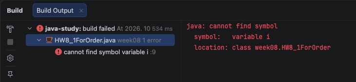

**→ 그럼 끝난 뒤의 i 를 보고 싶으면 어떻게 하면 될까요.   
`int i;` 를 for 밖으로 꺼내서 `for (i = 1; i <= 5; i++)` 로 바꾸고 돌려보세요.    
끝난 뒤 i 는 몇인가요. 예상부터. (5 가 아닙니다 ㅎ)**   
예상: 6

#### - 실행 결과
```
    1
    2
    3
    4
    5
    끝난 뒤 i: 6
```
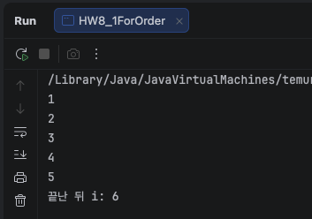   
***

### 8-2. 몇 번 도나요 — off-by-one
아래 여섯 개가 각각 몇 번 도는지 예상부터 적으세요.
```java
    ① for (int i = 0; i < 10; i++)
    ② for (int i = 1; i <= 10; i++)
    ③ for (int i = 0; i <= 10; i++)
    ④ for (int i = 1; i < 10; i++)
    ⑤ for (int i = 1; i <= 10; i += 2)
    ⑥ for (int i = 10; i > 0; i -= 3)
```
**조건 1: 본문에 count++ 를 넣어서 실제 횟수를 세고, 예상이랑 표로 비교할 것**   

#### - 예상 결과
```
    ① for (int i = 0; i < 10; i++)
    0 1 2 3 4 5 6 7 8 9 
    10번
    
    ② for (int i = 1; i <= 10; i++)
    1 2 3 4 5 6 7 8 9 10 
    10번
    
    ③ for (int i = 0; i <= 10; i++)
    0 1 2 3 4 5 6 7 8 9 10
    11번
    
    ④ for (int i = 1; i < 10; i++)
    1 2 3 4 5 6 7 8 9
    9번 
    
    ⑤ for (int i = 1; i <= 10; i += 2)
    1 3 5 7 9
    5번
    
    ⑥ for (int i = 10; i > 0; i -= 3)
    10 7 4 1
    4번
```

#### - 실행 결과
```
    ① 10번
    ② 10번
    ③ 11번
    ④ 9번
    ⑤ 5번
    ⑥ 4번
```
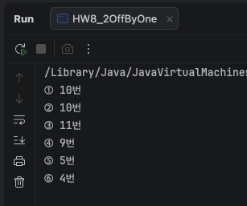   

| 번호 | 예상 | 실제(count) | 일치 |
|------|------|-------------|------|
| ①    | 10번 | 10번        | O    |
| ②    | 10번 | 10번        | O    |
| ③    | 11번 | 11번        | O    |
| ④    | 9번  | 9번         | O    |
| ⑤    | 5번  | 5번         | O    |
| ⑥    | 4번  | 4번         | O    |


**조건 2: ⑤ ⑥ 은 i 값도 한 줄로 찍어볼 것**   

```java
    int count = 0;
    for (int i = 1; i <= 10; i += 2) {
        System.out.print(i + " ");
        count++;
    }
    System.out.println("→ " + count + "번");
```
#### - 실행 결과
```
    ① 10번
    ② 10번
    ③ 11번
    ④ 9번
    ⑤ 5번
    ⑥ 4번
    
    // ⑤ ⑥  i 값 한 줄로 출력
    ① 10번
    ② 10번
    ③ 11번
    ④ 9번
    1 3 5 7 9 → 5번
    10 7 4 1 → 4번
```
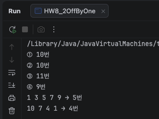   

**→ 틀린 게 있으면 어디서 틀렸는지 한 줄로.**   

**→ ① 이랑 ② 는 횟수가 같은데 i 가 다릅니다. 어떻게 다른지 한 줄로.**   
0부터 시작인지 1부터 시작인지가 다름   

**※ `<` 랑 `<=` 하나 차이로 한 번 더 돌거나 덜 도는 게 제일 흔한 버그입니다. 오류도 안 납니다. 6주차 표에서 어디에 들어갈지 적으세요.**   
오류 없이 틀린 답에 해당함 컴파일도 실행도 되고 결과만 틀림    
***

### 8-3. 합계 — 누적 변수는 어디에
1 부터 100 까지 더한 값을 출력하세요.
```text
    합계: 5050
```

**조건 1: `int sum = 0;` 은 for 밖에 둘 것**

#### - 실행 결과
```
    합계: 5050
```
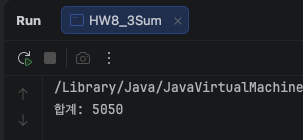

**→ 다 되면 `int sum = 0;` 을 for 안으로 옮겨서 돌려보세요.**
```java
    for (int i = 1; i <= 100; i++) {
        int sum = 0;
        sum += i;
    }
```
**먼저 컴파일이 되나요. 안 되면 메시지 그대로.   
(힌트: 8-1 이랑 같은 이유로 for 밖에서 sum 을 못 씁니다. 출력 줄도 안으로 넣어서 돌려보세요)    
마지막에 찍히는 값은 얼마인가요. 예상부터. 왜 그런지 한 줄로.**   
컴파일 안됨   
반복문을 한 번 돌 때 마다 sum = 0으로 리셋되고 i값이 sum에 더해짐    

#### - 오류 메시지
```
    HW8_3Sum.java:19
    java: cannot find symbol
      symbol:   variable sum
      location: class week08.HW8_3Sum
```

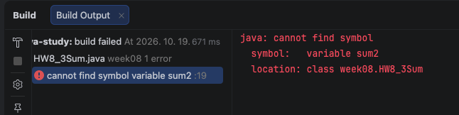

마지막에 찍히는 값은 합계: 100   
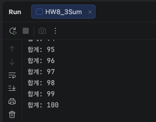

**→ 1 부터 100 까지 중 3 의 배수만 더하세요. 두 가지로.**
```text
    방법 A   i 는 1 씩 올리고, 안에서 if (i % 3 == 0) 일 때만 더하기
    방법 B   i 를 3 부터 시작해서 i += 3
```
조건: 두 방법 결과가 같은지, 그리고 각각 몇 번 도는지 count 로 세서 적을 것   
**→ 어느 쪽이 나은지 한 줄로.**
두 방법의 결과가 같음   
B 방법이 더 나음   
모든 수를 거쳐서 연산할 필요 없이 3의 배수만 걸러서 계산 할 수 있음   

#### - 실행 결과
```
    방법 A 합계: 1683, 도는 횟수: 100
    방법 B 합계: 1683, 도는 횟수: 33
```
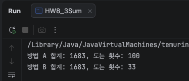
***

### 8-4. 팩토리얼 — 곱하기 누적
숫자 n 을 입력받아 n! 을 출력하세요.
```text
    n: 5
    5! = 120
    
    5! = 1 × 2 × 3 × 4 × 5
```
**조건 1: 0, 1, 5, 12, 13, 20 을 넣고 결과를 적을 것 (0! 은 1 입니다)**   

#### - 실행 결과
```
    0! = 1
    
    0! = 
    
    
    (0 은 곱할 게 없어서 "0! = " 뒤가 빈 줄로 나옴)
    
    n: 1
    1! = 1
    
    1! = 1
    
    
    n: 5
    5! = 120
    
    5! = 1 × 2 × 3 × 4 × 5
    
    
    n: 12
    12! = 479001600
    
    12! = 1 × 2 × 3 × 4 × 5 × 6 × 7 × 8 × 9 × 10 × 11 × 12
    
    
    n: 13
    13! = 1932053504
    
    13! = 1 × 2 × 3 × 4 × 5 × 6 × 7 × 8 × 9 × 10 × 11 × 12 × 13
    
    
    n: 20
    20! = -2102132736
    
    20! = 1 × 2 × 3 × 4 × 5 × 6 × 7 × 8 × 9 × 10 × 11 × 12 × 13 × 14 × 15 × 16 × 17 × 18 × 19 × 20


```
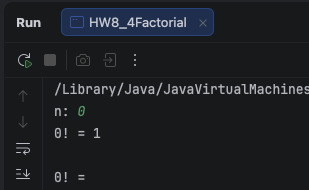   
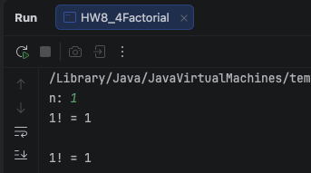   
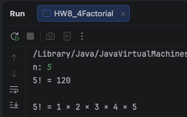   
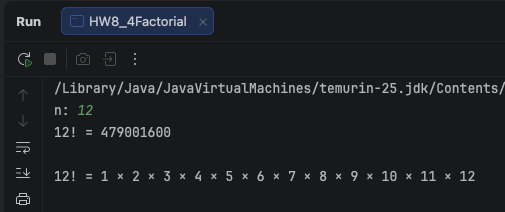   
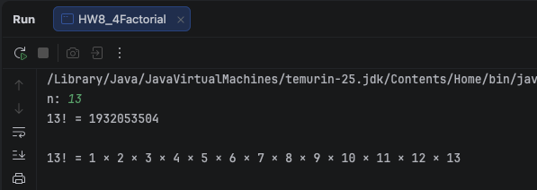   

**조건 2: 음수는 "음수는 안 됩니다" (6주차처럼 먼저 거르기)**
```
    n: -3
    음수는 안 됩니다
```

**→ 곱하기 누적 변수의 시작값을 0 으로 하면 어떻게 되나요. 예상부터 적고 돌려보세요. 더하기는 0 에서 시작했는데 곱하기는 왜 다른지 한 줄로.**   
0  
0은 무슨 수를 곱해도 0이됨   

**→ 13 이랑 20 은 뭐가 나왔나요. 계산기로 13! 을 직접 구해서 비교하세요. 오류가 났나요? int 를 long 으로 바꾸고 다시 돌려보세요. 20 까지는 맞는지, 21 은 어떤지.**   
#### - 실행 결과
```
    13! = 1932053504   
    20! = -2102132736   
    
    
    계산기 13! = 6,227,020,800   
    계산기 20! = 2,432,902,008,176,640,000   
    
    
    // int → long 변경 후
    n: 13
    13! = 6227020800
    
    13! = 1 × 2 × 3 × 4 × 5 × 6 × 7 × 8 × 9 × 10 × 11 × 12 × 13
    
    n: 20
    20! = 2432902008176640000
    
    20! = 1 × 2 × 3 × 4 × 5 × 6 × 7 × 8 × 9 × 10 × 11 × 12 × 13 × 14 × 15 × 16 × 17 × 18 × 19 × 20
    
    
    n: 21
    21! = -4249290049419214848
    
    21! = 1 × 2 × 3 × 4 × 5 × 6 × 7 × 8 × 9 × 10 × 11 × 12 × 13 × 14 × 15 × 16 × 17 × 18 × 19 × 20 × 21
```
int → long 변경 후   
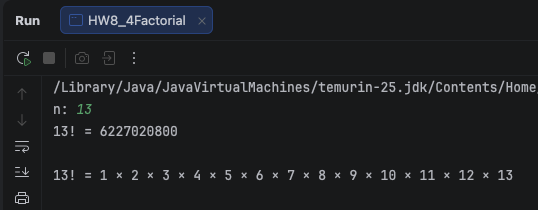   
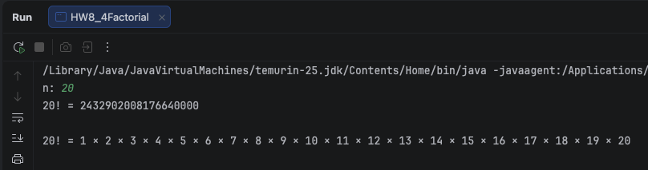     
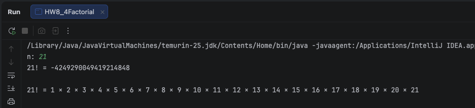   

오류는 발생하지 않았으나 값이 틀렸음   

```text
int    -2,147,483,648 ~ 2,147,483,647   약 ± 21억
long   훨씬 크다                          약 ± 922경
```
13! int의 한계를 넘었음 자바는 그 자리에서 멈추지 않고 넘친 채로 그냥 계속 담아버려서 엉뚱한 값(20!은 음수까지)이 나옴    
long으로 바꾸면 범위가 약 ±922경까지 늘어나서 13!, 20!까지는 맞지만 21!은 long의 한계를 또 넘어서 넘침   
int는 딱 32비트만 쓸 수 있는데 13!의 진짜 값(6,227,020,800)은 그릇의 총 용량($2^{32} = 4,294,967,296$)을 한 번 넘어감   

```
    13! 진짜 값         = 6,227,020,800                                                                                                                                                                           
    한 바퀴(2³²)        = 4,294,967,296                                                                                                                                                                                
    넘친 만큼만 남음     = 6,227,020,800 - 4,294,967,296 = 1,932,053,504

    20! 진짜 값          = 2,432,902,008,176,640,000                                                                                                                                                                   
    한 바퀴(2³²)         = 4,294,967,296                                                                                                                                                                               
    그릇을 여러 바퀴 채우고 남은 양 = 2,192,834,560   (2,432,902,008,176,640,000 을 4,294,967,296 으로 나눈 나머지)      
```

**→ 20!이 왜 음수로 나왔는지**   
int 32비트 공간 중 맨 앞 1비트는 부호 표시(양수/음수)로 사용되므로, 표현 가능한 범위가 앞쪽 절반(0 ~ 2,147,483,647, 양수 영역)과 뒤쪽 절반(2,147,483,648 ~ 4,294,967,295, 음수 영역)으로 나뉨.   
```
2,192,834,560 - 4,294,967,296 = -2,102,132,736
```
20!의 나머지(2,192,834,560)는 앞쪽 절반의 한계(2,147,483,647)를 넘어서 뒤쪽 절반(음수 담당 영역)에 들어가고, 이 영역의 값은 컴퓨터의 부호 표현 방식에 의해 용량에서 뺀 값으로 계산되어 음수로 보임   

**※ 이것도 6주차 표 어디에 들어갈지 적으세요. 이번 주에 오류 없이 틀린 답이 제일 많이 나옵니다.**    
오류 없이 틀린 답   
컴파일도 실행도 되고 담을 수 있는 범위를 넘어서 값만 틀리게 나옴.
***

### 8-5. 세미콜론 하나
아래를 그대로 쳐서 돌리세요.
```java
    for (int i = 1; i <= 5; i++); {
        System.out.println("안녕");
    }
```
**→ "안녕" 이 몇 번 나오나요. 예상부터.**   
예상을 하기전에 결과를 보았음  
#### - 실행 결과

```
    안녕
```
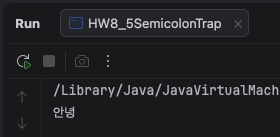   

**→ Ctrl + Alt + L 을 누르면 모양이 어떻게 바뀌나요. 바뀐 모양 그대로 붙여넣기.**    
#### - 실행 결과
```java
    for (int i = 1; i <= 5; i++) ;
    {
        System.out.println("안녕");
    }
```
**→ 6주차 6-4 ① `if (score >= 60); {` 랑 같은 이야기입니다. 이어서 한 줄로.**   
`;`가 바로 for문을 끝내고 뒤에 { }는 반복과 상관 없이 한 번 실행되는 별개의 코드가 됨   

**→ 이번엔 `println("안녕")` 을 `println(i)` 로 바꿔보세요. 이번엔 컴파일이 되나요.    
메시지 그대로 + 줄 번호. 같은 `;` 실수인데 왜 이번엔 컴파일러가 잡아주는지 한 줄로. (8-1 힌트)**   
`안녕`은 문자열이라 for와 상관 없이 출력 되지만 i는 for안의 변수라서 오류가 발생. for 안에서 만든 변수는 for 밖에서 안 보임   

#### - 오류 메시지
```
    HW8_5SemicolonTrap.java:20
    java: cannot find symbol
      symbol:   variable i
      location: class week08.HW8_5SemicolonTrap
```

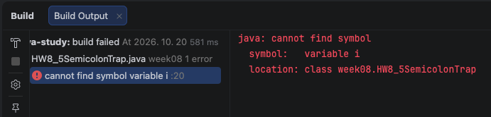   

**→ 마지막으로 증감식(`i++`)을 지워보세요.**
```java
    for (int i = 1; i <= 5; ) {
        System.out.println(i);
    }
```
**뭐가 나오나요. IntelliJ 실행 창의 빨간 네모(Stop) 버튼으로 멈추세요.   
왜 안 끝나는지 한 줄로. 캡처는 멈춘 다음 한 장이면 됩니다.**   
증감식(i++)이 없어 i가 1에서 영원히 안 바뀜   
조건식 i <= 5가 항상 true이고 끝날 방법이 없음   

#### - 실행 결과
```
    1
    1
    1
    1
    1
    1
    .....
```
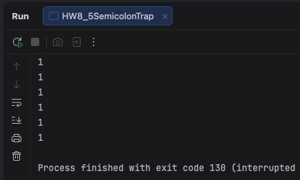   
***

## 도전 과제
### 도전 1. 구구단
먼저 3단만 for 하나로 출력하세요.
```text
    3 x 1 = 3
    3 x 2 = 6
    ...
    3 x 9 = 27
```
**조건 1: printf 로 찍을 것 (1주차 도전2)**
#### - 실행 결과
```
    3 x 1 = 3
    3 x 2 = 6
    3 x 3 = 9
    3 x 4 = 12
    3 x 5 = 15
    3 x 6 = 18
    3 x 7 = 21
    3 x 8 = 24
    3 x 9 = 27
```
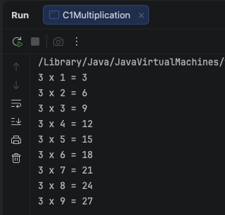

**그 다음 2단부터 9단까지 전부 출력하세요. for 안에 for 가 들어갑니다.**   
#### - 실행 결과
```
    2 x 1 = 2
    2 x 2 = 4
    2 x 3 = 6
    2 x 4 = 8
    2 x 5 = 10
    2 x 6 = 12
    2 x 7 = 14
    2 x 8 = 16
    2 x 9 = 18
    
    3 x 1 = 3
    3 x 2 = 6
    3 x 3 = 9
    3 x 4 = 12
    3 x 5 = 15
    3 x 6 = 18
    3 x 7 = 21
    3 x 8 = 24
    3 x 9 = 27
    
    4 x 1 = 4
    4 x 2 = 8
    4 x 3 = 12
    4 x 4 = 16
    4 x 5 = 20
    4 x 6 = 24
    4 x 7 = 28
    4 x 8 = 32
    4 x 9 = 36
    
    5 x 1 = 5
    5 x 2 = 10
    5 x 3 = 15
    5 x 4 = 20
    5 x 5 = 25
    5 x 6 = 30
    5 x 7 = 35
    5 x 8 = 40
    5 x 9 = 45
    
    6 x 1 = 6
    6 x 2 = 12
    6 x 3 = 18
    6 x 4 = 24
    6 x 5 = 30
    6 x 6 = 36
    6 x 7 = 42
    6 x 8 = 48
    6 x 9 = 54
    
    7 x 1 = 7
    7 x 2 = 14
    7 x 3 = 21
    7 x 4 = 28
    7 x 5 = 35
    7 x 6 = 42
    7 x 7 = 49
    7 x 8 = 56
    7 x 9 = 63
    
    8 x 1 = 8
    8 x 2 = 16
    8 x 3 = 24
    8 x 4 = 32
    8 x 5 = 40
    8 x 6 = 48
    8 x 7 = 56
    8 x 8 = 64
    8 x 9 = 72
    
    9 x 1 = 9
    9 x 2 = 18
    9 x 3 = 27
    9 x 4 = 36
    9 x 5 = 45
    9 x 6 = 54
    9 x 7 = 63
    9 x 8 = 72
    9 x 9 = 81
```
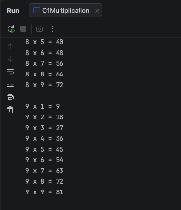

**조건 2: 단이 바뀔 때 빈 줄 하나**   
**→ 전부 몇 줄 출력되나요. 바깥 for 몇 번 × 안쪽 for 몇 번으로 예상부터.**   
```
예상
빈 줄 포함 전체 줄수: 80줄 (빈 줄 제외 72줄)      
바깥 for 8번 x 안쪽 for 9번 = 72줄

실제 결과 
빈 줄 포함 전체 줄수: 80줄 (빈 줄 제외 72줄)      
바깥 for 8번 x 안쪽 for 9번 = 72줄
```

**→ 안쪽 for 변수 이름을 바깥이랑 같은 i 로 바꿔보세요. 오류 메시지 그대로 + 줄 번호. 8-1 이랑 이어서 한 줄로.**    
바깥 for에서 사용하고 있는 i를 그 범위 안에 있는 안쪽 for에서 똑같은 이름을 사용하려고 해서    
이미 정의된 이름은 다시 사용할 수 없음 

#### - 오류 메시지 
```
    C1Multiplication.java:15
    java: variable i is already defined in method main(java.lang.String[])
```
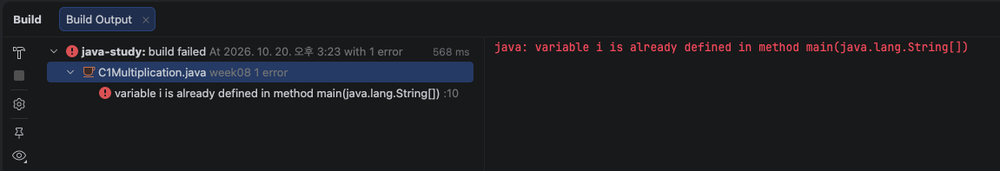
***

### 도전 2. 별 삼각형
줄 수 n 을 입력받아 별 삼각형을 찍으세요.
```text
    n: 4
    *
    **
    ***
    ****
```
**조건 1: 1주차 HW1_2 는 println 다섯 개였죠. 이번엔 n 이 100 이어도 코드가 그대로일 것**   

#### - 실행 결과
```text
    n: 4
    *
    **
    ***
    ****
```
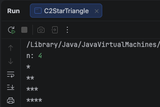   


**조건 2: 다 되면 오른쪽 정렬로 바꾸기**
```text
    n: 4
       *
      **
     ***
    ****
```
**→ 한 줄에 공백 몇 개, 별 몇 개인지 n 이랑 줄 번호로 먼저 적고 시작하세요.**
```text
    1번째 줄   공백 3     별 1
    2번째 줄   공백 2     별 2
    k번째 줄   공백 n-k   별 k
```
이 표만 맞으면 코드는 금방입니다.   


#### - 실행 결과
```text
    n: 4
       *
      **
     ***
    ****
```
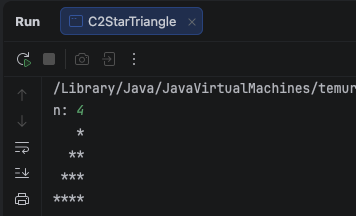   
***


### 도전 3. 메뉴 — for 로 3번
7주차 도전3 C3Menu 를 가져와서, 메뉴가 3번 나오게 for 로 감싸세요.
```text
    1. 입력  2. 조회  3. 삭제  0. 종료
    선택: 2
    조회를 선택했습니다
    1. 입력  2. 조회  3. 삭제  0. 종료
    선택: 1
...
```
**조건 1: 지금 abc 를 받으면 return 으로 끝나죠. 이번엔 return 을 빼고, "잘못된 입력입니다" 만 찍고 다음 바퀴로 가게 할 것 (if · else 로)**    

**조건 2: 1 2 3 으로 한 번, 0 2 1 로 한 번, abc 2 3 으로 한 번 돌리고 결과를 적을 것**   

#### - 실행 결과
```
    // 1 2 3
    1. 입력  2. 조회  3. 삭제  0. 종료
    선택: 1
    입력을 선택했습니다
    1. 입력  2. 조회  3. 삭제  0. 종료
    선택: 2
    조회를 선택했습니다
    1. 입력  2. 조회  3. 삭제  0. 종료
    선택: 3
    삭제를 선택했습니다
    
    // 0 2 1
    1. 입력  2. 조회  3. 삭제  0. 종료
    선택: 0
    종료를 선택했습니다
    1. 입력  2. 조회  3. 삭제  0. 종료
    선택: 2
    조회를 선택했습니다
    1. 입력  2. 조회  3. 삭제  0. 종료
    선택: 1
    입력을 선택했습니다
    
    // abc 2 3
    1. 입력  2. 조회  3. 삭제  0. 종료
    선택: abc
    잘못된 입력입니다
    1. 입력  2. 조회  3. 삭제  0. 종료
    선택: 2
    조회를 선택했습니다
    1. 입력  2. 조회  3. 삭제  0. 종료
    선택: 3
    삭제를 선택했습니다

```
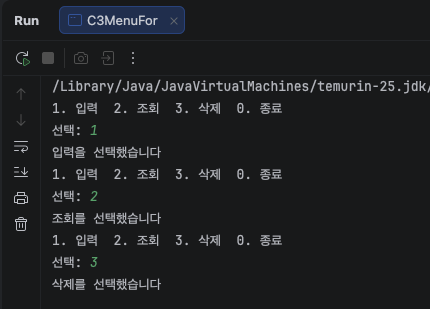   
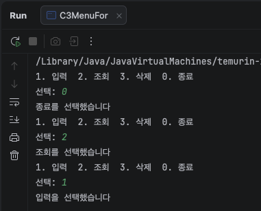   
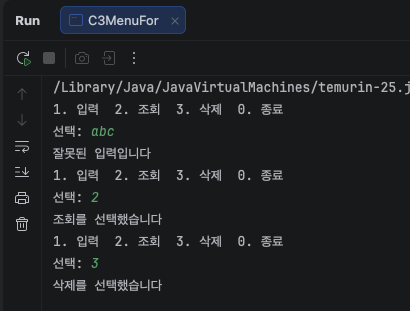   

**→ 0 을 눌렀는데 메뉴가 또 나오나요. "0 을 누르면 끝"을 for 로 하기가 왜 어색한지 한 줄로. (힌트: for 는 처음에 몇 번 돌지 정해두고 시작합니다)**   
또 나옴 (0 2 1 케이스)    
for는 시작할때 이미 몇 번 돌지 정해놓고 시작하는데 중간에 0을보고 끝낼 수 있는 방법이 없음   

※ if (menu == 0) return;을 쓸수는 없나?   
- for는 처음부터 "i <= 3이니까 3번 돈다"는 정해진 횟수를 약속하고 시작하는 문법인데, return을 넣는 순간 그 약속은 사실상 의미가 없어집니다. 실제로 몇 바퀴 돌지는 i가 아니라 "언제 0이 나오느냐"에 달려있는데, i <=
  3이라는 상한선은 0이 안 나오면 그냥 3번 채우고 끝나는 숫자일 뿐, 진짜 멈추는 이유(0)와는 무관합니다.   
- 즉, 멈추는 규칙이 두 개가 됩니다 (i <= 3 그리고 menu == 0). 진짜 원하는 건 "0이 나올 때까지 돈다" 하나뿐인데, for 문법에 억지로 끼워 맞추려고 return으로 뚫고 나가는 셈입니다.   
- 그리고 return으로 메서드를 통째로 끝내버리면, for 밑에 있는 sc.close()도 실행이 안 됩니다 (지금은 프로그램이 바로 끝나서 큰 문제는 없지만, "정리를 안 하고 나간다"는 점에서 깔끔하지 않습니다).       
라는 AI의 답변.    
한 줄로 정리하면 — for 는 횟수로 멈추는 문법인데 0 으로 멈추려니 멈추는 규칙이 둘이 돼서 어색함   

**→ abc 2 3 을 넣었을 때 2 랑 3 이 제대로 들어갔나요. 예상부터. 안 들어갔으면 왜 그런지 한 줄로. (힌트: 5주차 5-2 에서 엔터가 남아있던 것과 같은 규칙. abc 는 누가 가져갔나요?) 고칠 수 있으면 고쳐보세요. 한 줄이면 됩니다.**   
조건 2 실행시 오류 발견하여 그 시점에 sc.next();를 추가하였음   
조건 2 실행시 2와 3이 제대로 들어가지 않았고 abc 2 3을 다 넣어도 아래같이 출력됨   
hasNextInt()가 false여도 abc를 버퍼에서 치우지 않으니 다음 바퀴도 똑같은 abc를 또 보기 때문 (5-2에서 엔터가 안 치워져서 계속 남아있던 것과 같은 규칙)
hasNextInt()가 false일 때 sc.next()로 abc를 직접 읽어서 버퍼에서 치워주면 다음 바퀴부터 2, 3이 제대로 들어가 해당 값이 출력 됨     
#### - 실행 결과
```
1. 입력  2. 조회  3. 삭제  0. 종료
선택: abc
잘못된 입력입니다
1. 입력  2. 조회  3. 삭제  0. 종료
선택: 잘못된 입력입니다
1. 입력  2. 조회  3. 삭제  0. 종료
선택: 잘못된 입력입니다
```
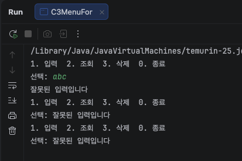

**※ 다음 주(9주차 while)에 이 문제를 또 씁니다. 그때 진짜 "0 누를 때까지"가 됩니다. 파일 지우지 마세요.**
***

## 힌트

for 는 세 칸입니다.
```java
for (초기식; 조건식; 증감식) {
    본문
}
```
```text
초기식   맨 처음 한 번만        int i = 1
조건식   매 바퀴 시작 전에       i <= 5      true 면 본문, false 면 끝
증감식   매 바퀴 끝날 때         i++
```
도는 순서
```text
초기식 → 조건식 → 본문 → 증감식 → 조건식 → 본문 → 증감식 → … → 조건식(false) → 끝
```
그래서 조건식은 본문보다 항상 한 번 더 검사합니다. 마지막 false 한 번.

몇 번 도는지 세는 습관
```text
0 부터 시작하면 <         for (int i = 0; i < 10; i++)     10번 (0~9)
1 부터 시작하면 <=        for (int i = 1; i <= 10; i++)    10번 (1~10)
```
헷갈리면 돌리기 전에 첫 바퀴 i 랑 마지막 바퀴 i 를 먼저 적으세요.

누적 변수
```text
합계   int sum = 0;       sum += i;
곱     int fact = 1;      fact *= i;
개수   int count = 0;     count++;
```
셋 다 for 밖에서 만듭니다. 안에서 만들면 매 바퀴 처음으로 돌아갑니다.

for ( ) 안에서 만든 변수는 for 안에서만 쓸 수 있습니다.   
6주차 { } 안의 age 랑 같은 규칙입니다.   
`for (int i ...)` 의 i 는 for 가 끝나면 없어집니다.

무한 루프   
조건이 계속 true 면 안 끝납니다. 대부분 증감식을 빼먹은 겁니다.   
IntelliJ 실행 창의 빨간 네모(Stop) 로 멈춥니다. 터미널이면 Ctrl + C.

흔한 실수
```text
for (...);  { }           ; 하나로 본문이 비어버림. 6-4 ① 이랑 같음
누적 변수를 for 안에      매 바퀴 0 으로 초기화
i++ 를 본문에서 또 씀     두 칸씩 올라감
< 와 <= 헷갈림            한 번 더 돌거나 덜 돎. 오류 없음
```

## 제출 전 확인
- [x] 8-1 표를 돌리기 전에 채웠는가
- [x] 8-2 여섯 개 예상을 먼저 적고 count 로 확인했는가
- [x] 8-3 sum 을 for 밖에 두었는가 (안에 둔 건 실험으로 주석)
- [x] 8-3 3 의 배수 두 방법 결과와 횟수를 적었는가
- [x] 8-4 시작값 0 실험, 13 · 20 · 21 결과를 적었는가
- [x] 8-5 Ctrl + Alt + L 결과를 붙였는가
- [x] 도전3 abc 2 3 결과를 적었는가
- [x] 실험 줄은 주석 + 바로 밑에 메시지, 최종 코드는 살아있는가
- [x] README 결과가 저장소 코드로 돌린 결과와 같은가
- [x] 커밋 전 Ctrl + Alt + L
***