# Week 09 반복문 `while` · `do-while`

## 학습 기간
2026-10-26 ~ 2026-11-02
***

지난주 `for` 는 "같은 줄을 몇 번 탈지" 를 정해두고 시작했다.   
그래서 돌리기 전에 몇 번 돌지 셀 수 있었다.

그런데 지난주 도전3 에서 직접 봤다.   
"0 누를 때까지" 는 `for` 로 하기가 어색하다고.   
몇 번 돌지는 사용자가 0 을 언제 누르느냐에 달렸으니까, 처음엔 아무도 모른다.   
그럴 때 쓰는 게 `while` 이다.

그래서 이번 주는 질문이 하나 바뀐다.   
`for` 는 "이거 몇 번 도는데?" 였고,   
`while` 은 "이거 언제 끝나는데?" 다.   
돌리기 전에 횟수 대신 끝나는 조건을 먼저 적고 돌려보자.

지난주 과제에서 물어봤던 "`if (menu == 0) return;` 은 안 되나" 도 이번 주 도전1 에서 직접 답이 나온다.

## 과제 내용
### 9-1. `for` 를 `while` 로 옮기기
8-1 의 `for` 를 `while` 로 다시 쓰세요.
```java
    for (int i = 1; i <= 5; i++) {
        System.out.println(i);
    }
```
**조건 1: `for` 의 세 칸(초기식 · 조건식 · 증감식)이 `while` 에서는 각각 어디로 갔는지 주석으로 적을 것**   

**조건 2: 8-1 처럼 표를 돌리기 전에 먼저 채울 것 (바퀴 · i 값 · 조건 · 출력)**
```text
    바퀴   i 값   조건   출력
    1     1     true   1
    2     2     true   2
    3     3     true   3
    4     4     true   4
    5     5     true   5
    6     6     false  (끝)
```

#### - 실행 결과
```
1
2
3
4
5
```
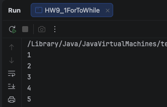   

**→ `for` 가 끝난 다음 줄에 넣었던 그 줄을 `while` 뒤에도 넣어보세요.**
```java
    System.out.println("끝난 뒤 i: " + i);
```
**8-1 에서는 오류가 났죠. 이번엔 어떤가요. 왜 다른지 한 줄로. (힌트: i 가 어디서 만들어졌나요)**   
오류가 발생하지 않음   
i가 `while`문 외부에서 만들어졌기때문   

#### - 실행 결과
```
1
2
3
4
5
끝난 뒤 i: 6
```
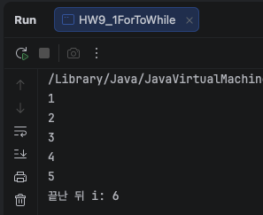

**→ `i++` 를 지워보세요. 뭐가 나오나요. 8-5 마지막이랑 같은가요.   
빨간 네모로 멈추고, 왜 안 끝나는지 한 줄로.**   
1이 무한 출력됨 

#### - 실행 결과
```
1
1
1
1
1
...
```
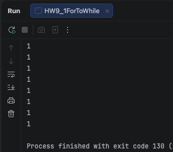


**→ `i++` 를 `println` 위로 옮겨보세요. 출력이 어떻게 바뀌나요. 예상부터.   
`for` 에서는 `i++` 자리가 정해져 있었는데 `while` 은 왜 자리를 신경 써야 하는지 한 줄로.**   
예상: 2
`for`는 `i++`가 들어갈 자리(세 번째 칸)가 이미 정해져 있어서 항상 본문이 끝난 뒤에 실행되지만 `while`은 `i++`의 자리가 정해져 있지 않고 본문 안에서 사용되는 코드로 쓰는 위치에 따라 출력 순서가 바뀜   
`i++`를 먼저 실행 후 출력했기 때문에 2가 됨
```text
for ( 초기식 ; 조건식 ; 증감식 ) {                                                                                                                                                                                 
      본문                                                                                                                                                                                                           
  }  
```
***

### 9-2. 자릿수 세기 · 자릿수 합
숫자를 입력받아 몇 자리인지, 각 자리 숫자의 합이 얼마인지 출력하세요.
```text
    숫자: 12345
    5자리
    자릿수 합: 15
```
**조건 1: `for` 가 아니라 `while` 로 쓸 것**  

**조건 2: 돌리기 전에 아래 표를 먼저 채울 것**
```text
    바퀴   num      num % 10   num / 10   count   sum
     1    12345    5          1234       1       5
     2    1234     4          123        2       9       
     3    123      3          12         3       12
     4    12       2          1          4       14
     5    1        1          0          5       15
```

#### - 실행 결과
```
숫자: 12345
5자리
자릿수 합 15
```
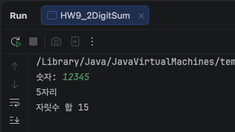   

**→ 왜 이 문제는 `for` 로 쓰기 어려운가요. 한 줄로. (힌트: 자릿수가 몇인지 미리 아나요?)**   
숫자를 입력 받기 전에는 몇 자리 인지 미리 알 수 없어 조건식에 넣을 수 있는 반복 횟수가 없음

**→ 0 을 넣어보세요. 몇 자리라고 나오나요. 맞나요.   
예상부터 적고 돌리세요. 왜 그런지 한 줄로. 고칠 수 있으면 고쳐보세요.   
(힌트: `while` 의 조건이 처음부터 `false` 면 몇 번 도나요)** 
#### - 예상 결과
```
숫자: 0
0자리
자릿수 합 0
```
#### - 실행 결과
```
숫자: 0
0자리
자릿수 합 0
```
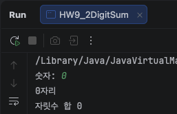   
`while` 조건이 처음부터 `false`이기 때문에 count와 num의 초기값이 출력됨   

#### - 수정 후 실행 결과
```
숫자: 0
1자리
자릿수 합 0
```
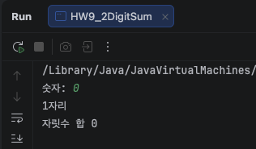    

**→ -123 을 넣어보세요. 뭐가 나오나요. 6주차 표에서 어디에 들어갈지 적으세요.   
고치는 건 안 해도 됩니다. 왜 그런지만 한 줄로.**   
오류 없이 틀린 답   
num이 음수면 `while` 조건이 처음부터 `false`이기 때문에 count와 num의 초기값이 출력됨      
0을 입력했을때와 동일한 현상   

#### - 실행 결과
```
숫자: -123
0자리
자릿수 합 0
```
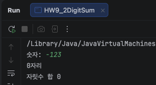   
***

### 9-3. 1000 을 처음 넘는 순간
1 부터 더해 나가서 합이 1000 을 처음 넘는 순간의 n 을 찾으세요.
```text
    n = 45, 합 = 1035
```
**조건 1: `while` 로 쓸 것. "몇 번 돌지" 가 아니라 "언제 끝나는지" 를 조건에 쓸 것**   

**조건 2: 돌리기 전에 n 이 대략 몇일지 예상을 적을 것 (틀려도 됩니다. 어림만)**   
위 답을 보아서 예상이 안됨

**→ 아래 두 모양이 어떻게 다른지 돌리기 전에 예상부터. 끝난 뒤 n 이 각각 몇인가요.**
```java
    ①  int n = 0, sum = 0;
        while (sum <= 1000) {
            n++;
            sum += n;
        }

    ②  int n = 1, sum = 0;
        while (sum <= 1000) {
            sum += n;
            n++;
        }
```

```java
    ①  int n = 0, sum = 0;
        while (sum <= 1000) {
            n++;
            sum += n;
        }
        // n = 45
                
    ②  int n = 1, sum = 0;
        while (sum <= 1000) {
            sum += n;
            n++;
        }
        // n = 46
```
**합은 둘 다 같은데 n 이 다릅니다. 왜 그런지 한 줄로.   
8-2 의 `<` 와 `<=` 랑 같은 종류인가요. 6주차 표의 어디인가요.**   
`n++`을 먼저하는지 나중에 하는지에 따른 차이가 있음   
8-2(오류 없이 틀린 답)와 같은 종류 아니며 n이 언제 증가하느냐에 따른 차이   
반복 횟수는 같고 n의 의미만 다른 것이라 6주차 표 해당 없음   

**→ 1000 을 10000, 100000 으로 바꿔보세요. n 이 몇인가요.   
`for` 로 쓰려면 `i <= ?` 에 뭘 넣어야 했을까요. 그게 왜 `while` 인지 한 줄로.**   
i <= 45 돌려보기 전엔 모름. 반복 횟수를 미리 알아야 `for` 를 쓸 수 있는데 몇 번째에서 넘을지 모르니 `while` 을 써야 함

#### - 실행 결과
```text
// 1000
n = 45, 합 = 1035

// 10000
n = 141, 합 = 10011

// 100000
n = 447, 합 = 100128

```
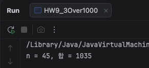   
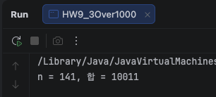   
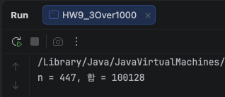    

***

### 9-4. 숫자 뒤집기
숫자를 입력받아 뒤집어 출력하세요.
```text
    숫자: 12345
    뒤집은 수: 54321
```
**조건 1: 9-2 처럼 `% 10` 과 `/ 10` 을 쓸 것 (문자열로 바꾸는 방법은 쓰지 마세요. 그건 나중에)**  

**조건 2: 돌리기 전에 표를 먼저 채울 것**
```text
    바퀴   num      num % 10   reversed
     1     12345    5          5
     2     1234     4          54
     3     123      3          543
     4     12       2          5432
     5     1        1          54321
```

#### - 실행 결과
```
숫자: 12345
뒤집은 수: 54321
```
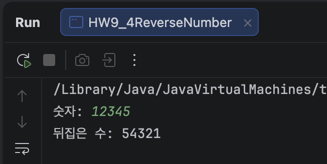    

**→ 1200 을 넣어보세요. 뭐가 나오나요. 예상부터.   
0021 이 아니라 21 이 나옵니다. 왜 그런지 한 줄로.   
이건 오류인가요, 틀린 답인가요, 아니면 맞는 답인가요. 생각을 한 줄로.   
(힌트: `int` 에 0021 이라는 수가 있나요)**   
1200의 뒤쪽 0들이 먼저 분리되어 0021으로 되는데 00으로 시작되는 숫자는 없음   
0021과 21은 결국 같은 값이기 때문에 맞는 답  

#### - 예상 결과
```
숫자: 1200
뒤집은 수: 0021
```

#### - 실행 결과
```
숫자: 1200
뒤집은 수: 21
```
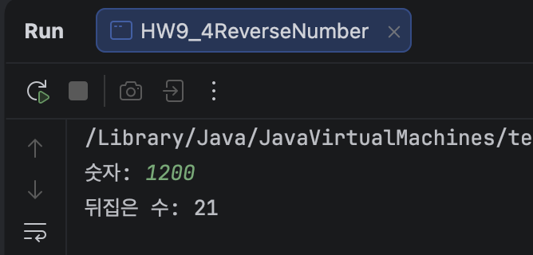

**→ 2147483647 (`int` 가 담을 수 있는 제일 큰 수) 을 넣어보세요. 뭐가 나오나요. 예상부터.   
음수가 나왔죠. 8-4 랑 같은 이야기인가요. 왜 그런지 한 줄로.   
계산기로 7463847412 랑 비교하고, 8-4 에서 했던 것처럼 2³² 로 나눠서 그 숫자가 맞는지 확인하세요.**   
음수
2147483647을 뒤집으면 하면 7463847412인데 `int` 최대값보다 크기 때문에 오버플로우 발생   

#### - 실행 결과
```
숫자: 2147483647
뒤집은 수: -1126087180
```
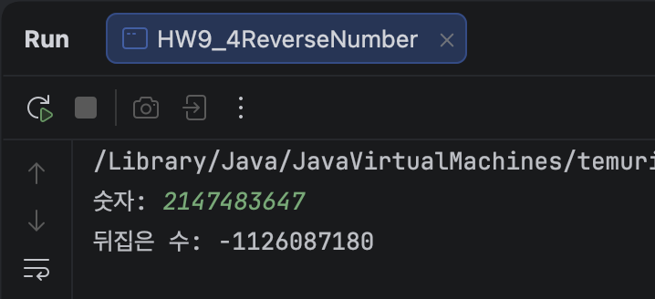    

7463847412 % 2³² = 3168880116    
이 값이 2³¹(2147483648) 보다 커서 2³² 를 다시 빼면 -1126087180
***

### 9-5. `do-while` — 한 번은 돈다
아래 두 개를 그대로 쳐서 돌리세요.
```java
    int i = 10;
    while (i < 5) {
        System.out.println("while: " + i);
        i++;
    }

    int j = 10;
    do {
        System.out.println("do-while: " + j);
        j++;
    } while (j < 5);
```
**→ 각각 몇 번 나오나요. 예상부터.**   
#### - 실행 결과
```java
    int i = 10;
    while (i < 5) {
        System.out.println("while: " + i); // 출력 없음 
        i++;
    }

    int j = 10;
    do {
        System.out.println("do-while: " + j); // do-while: 10
        j++;
    } while (j < 5);
```
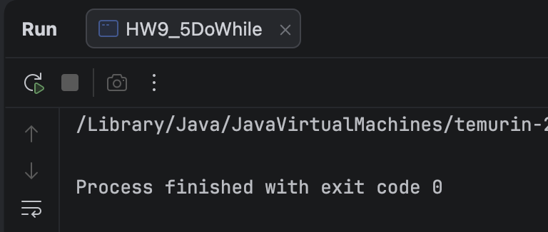   
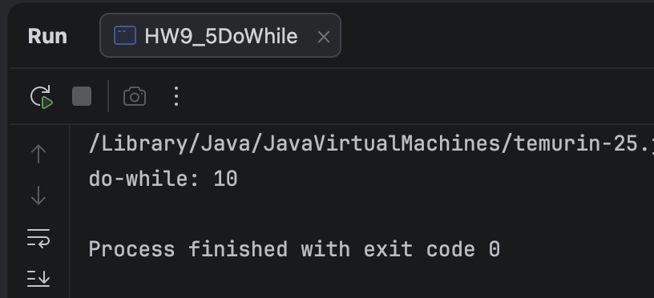   

**→ 조건이 같은데(10 < 5) 왜 결과가 다른지 한 줄로.   
(힌트: 조건을 언제 검사하나요. 들어가기 전인가요 나온 뒤인가요)**   
`while`: 들어가기전    
`do-while`: 나온 뒤   

**→ `do-while` 끝의 `;` 를 지워보세요. 오류 메시지 그대로 + 줄 번호.   
`for` 랑 `while` 은 `}` 뒤에 `;` 가 없는데 `do-while` 은 왜 있어야 하는지 한 줄로.**   
조건이 본문 뒤에 붙는 구조라 문장의 끝나는 지점을 알려줘야하기 때문에 `;`가 필요함   

#### - 오류 메시지
```
    HW9_5DoWhile.java:16
    java: ';' expected
```
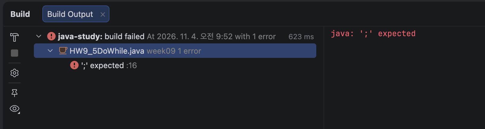

**→ 이번엔 `while` 에 `;` 를 붙여보세요. 8-5 처럼.**
```java
    int k = 1;
    while (k <= 5); {
        System.out.println(k);
        k++;
    }
```
**뭐가 나오나요. 예상부터. 8-5 에서는 "안녕" 이 한 번 나오고 끝났죠.   
이번엔 끝나나요. 빨간 네모로 멈추고, 같은 `;` 실수인데 `for` 랑 `while` 이 왜 다른지 한 줄로.   
(힌트: `for` 의 `;` 뒤엔 `i++` 가 있었고, `while` 의 `;` 뒤엔 뭐가 있나요)**   
`for`는 `()`로 묶여있고 `;` 뒤에 `i++`가 남아있어 조건이 진행되다 끝나지만 `while`은 k를 바꾸는 코드가 `{}`에 있어서 k가 안 바뀌어 안 끝남   

#### - 예상
```
   1
```

#### - 실행 결과
```
   출력없이 실행이 끝나지 않음  
```
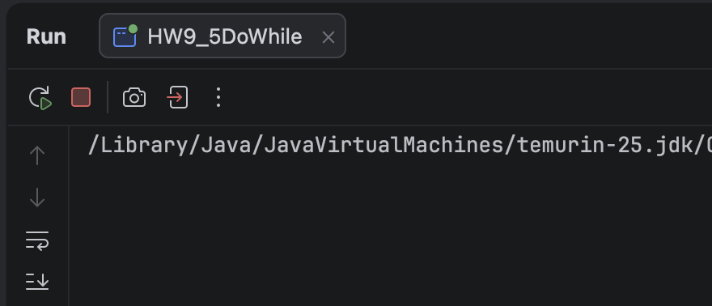   

**※ 이번 주에 제일 중요한 문제입니다.   
`for` 의 `;` 실수는 한 번 돌고 끝났는데, `while` 의 `;` 실수는 안 끝납니다.   
같은 실수가 더 위험한 쪽으로 옮겨간 겁니다.**
***

## 도전 과제
### 도전 1. 메뉴 — 진짜 "0 누를 때까지"
8주차 도전3 C3MenuFor 를 가져와서, 이번엔 0 을 누를 때까지 메뉴가 계속 나오게 하세요.
```text
    1. 입력  2. 조회  3. 삭제  0. 종료
    선택: 2
    조회를 선택했습니다
    1. 입력  2. 조회  3. 삭제  0. 종료
    선택: abc
    잘못된 입력입니다
    1. 입력  2. 조회  3. 삭제  0. 종료
    선택: 0
    종료합니다
```
**조건 1: `while` (`true`) + `break` 로 쓸 것**   
**조건 2: abc 처리(`hasNextInt` · `sc.next()`)는 8주차 그대로 살릴 것**   
**조건 3: 1 2 abc 3 0 을 넣어서 결과를 적을 것. 그리고 0 뒤에 7 을 더 넣어서 7 이 안 받아지는지 확인**   
**조건 4: `while` 이 끝난 다음 줄에 "종료합니다" 를 찍고, 그 밑에 `sc.close()`**

#### - 실행 결과
```
    1. 입력  2. 조회  3. 삭제  0. 종료
    선택: 1
    입력을 선택했습니다
    1. 입력  2. 조회  3. 삭제  0. 종료
    선택: 2
    조회를 선택했습니다
    1. 입력  2. 조회  3. 삭제  0. 종료
    선택: abc
    잘못된 입력입니다
    1. 입력  2. 조회  3. 삭제  0. 종료
    선택: 3
    삭제를 선택했습니다
    1. 입력  2. 조회  3. 삭제  0. 종료
    선택: 0
    종료합니다
    
    ================================
    
    1. 입력  2. 조회  3. 삭제  0. 종료
    선택: 07
    등록되지 않은 메뉴를 선택했습니다
    1. 입력  2. 조회  3. 삭제  0. 종료
    선택: 0
    종료합니다
    
```
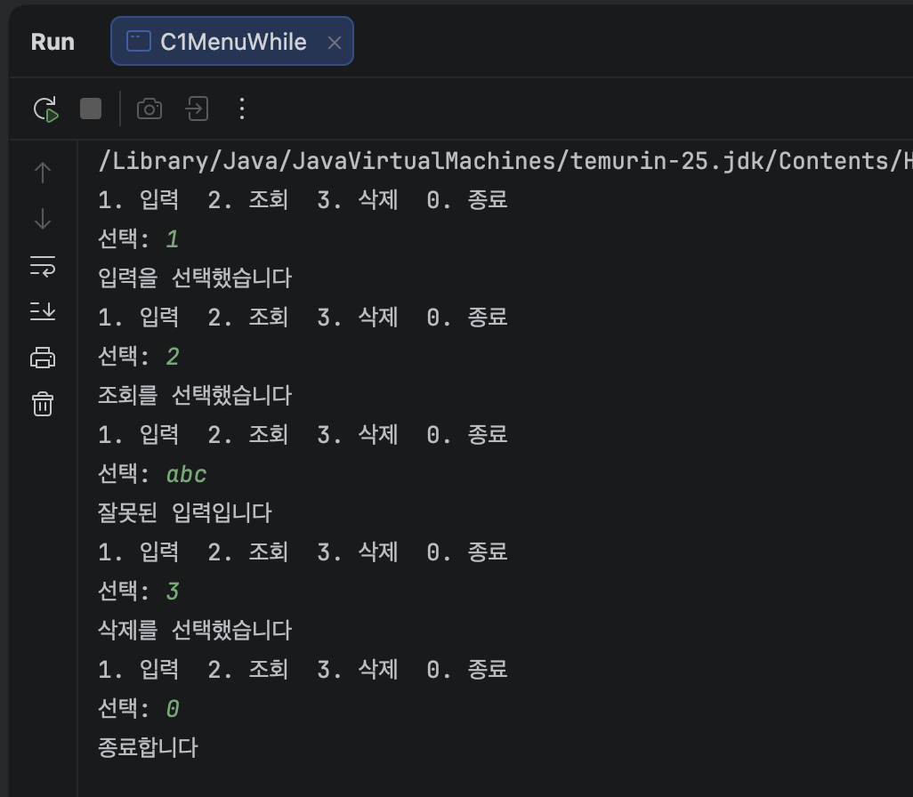   
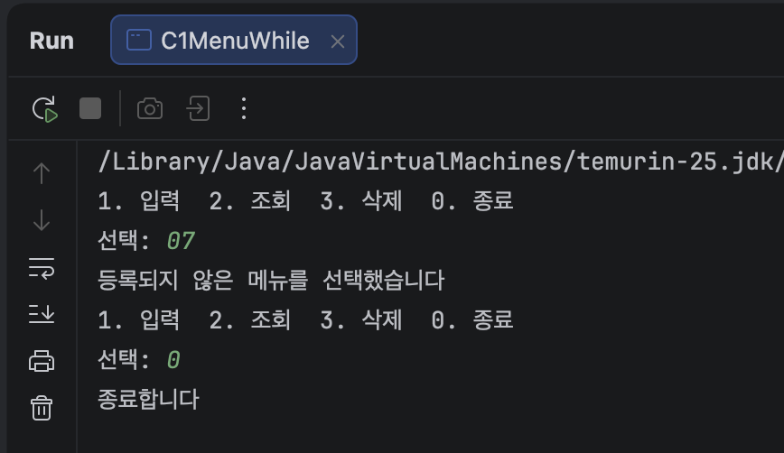   

**→ 8주차에 물어봤었죠. "`if (menu == 0) return;` 은 안 되나".   
`break` 를 `return` 으로 바꿔서 돌려보세요. 뭐가 달라지나요. (힌트: "종료합니다" 가 나오나요)   
`break` 랑 `return` 이 어디까지 나가는지 각각 한 줄로.**   

`break`는 가장 인접한 반복문을 빠져나가고 종료. `sc.cloase()`도 정상 실행   
`return`은 메서드 전체를 빠져 나가서 출력문과 `sc.cloase()`가 실행될 수 없음   

#### - 실행 결과
```
    C1MenuWhile.java:29
    java: unreachable statement
```
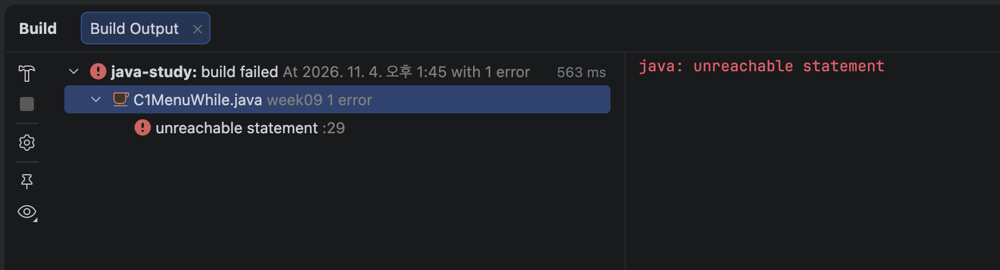    

**→ 이번엔 `do-while` 로 다시 쓰세요. `break` 없이 `} while (menu != 0);` 으로.   
abc 를 넣으면 어떻게 되나요. menu 에 뭐가 들어가야 하는데 abc 는 숫자가 아니죠.   
막히면 어디서 막혔는지 적으세요. 못 풀어도 됩니다. 어디가 어려운지만.   
(힌트: menu 를 do 밖에서 만들어야 `while` (menu != 0) 이 볼 수 있습니다. 8-1 i 랑 같은 이야기)**   
abc 는 `sc.next()` 로 버려져서 menu 에 대입되지 않음   
menu가 모든 경로에서 할당되지 않아 컴파일 에러로 막힘   

#### - 실행 결과
```
C1MenuWhile.java:50
java: variable menu might not have been initialized
```
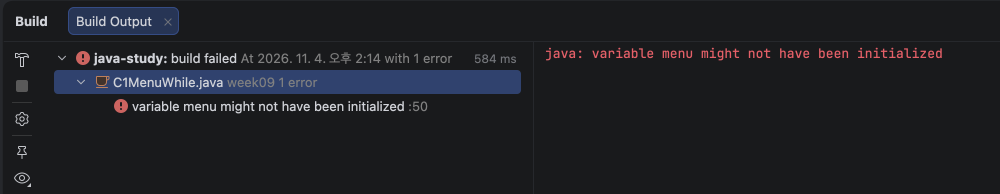

**→ `for` (3번) · `while` (`true`) + `break` · `do-while` 셋 다 써봤습니다.   
메뉴에는 어느 게 제일 맞는지, 왜 그런지 한 줄로.**   
`while`(`true`)+`break`가 제일 맞음    
menu가 선택값과 종료조건을 동시에 보지 않아도 되고 몇 번 돌지 모르는 상황에 가장 잘 맞음   

***

### 도전 2. 2 와 3 의 배수 빼고
1 부터 100 까지 중 2 의 배수도 아니고 3 의 배수도 아닌 수를 한 줄에 출력하세요.
```text
    1 5 7 11 13 17 19 23 25 ...
```
**조건 1: `while` 로 쓸 것**   
**조건 2: 몇 개 나올지 예상부터 적고, count 로 세서 비교할 것   
(힌트: 100 - 2의 배수 - 3의 배수 + 둘 다인 수. 6의 배수는 두 번 빼니까)**   
**조건 3: 8-3 처럼 if 로 거르는 방법 하나로만. (i += 6 같은 꼼수는 다음에 ㅎ)**
예상: 33개   

#### - 실행 결과
```
    1 5 7 11 13 17 19 23 25 29 31 35 37 41 43 47 49 53 55 59 61 65 67 71 73 77 79 83 85 89 91 95 97   
    33개
```
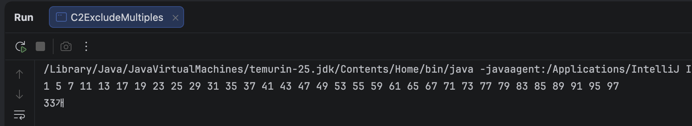   

**→ `i++` 를 if 안에 넣어보세요.**
```java
    while (i <= 100) {
        if (i % 2 != 0 && i % 3 != 0) {
            System.out.print(i + " ");
            i++;
        }
    }
```
**뭐가 나오나요. 예상부터. 빨간 네모로 멈추고, 어디서 멈춰 있는지 i 값으로 한 줄.   
(힌트: i 가 2 가 되면 if 안으로 들어가나요)   
예상: 모르겠음   
멈춘 지점: `i = 2`

#### - 실행 결과
```
1 출력 후 멈춤
```
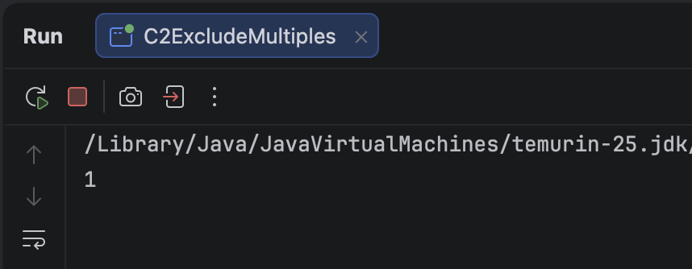

`for` 였으면 이 실수가 생길 수 있나요. 왜 `while` 에서만 생기는지 한 줄로.**   
`for`는 증감식이 세번째 칸에 있어서 if 안에 넣을 수 없지만 `while`은 증감식 위치를 직접 정해야 해서 if 안에 두는 실수가 생길 수 있음
***

### 도전 3. 0 이 나올 때까지 더하기 — 보초값
숫자를 계속 입력받아 더하다가, 0 을 입력하면 멈추고 합계 · 개수 · 평균을 출력하세요.
```text
    숫자 (0이면 종료): 10
    숫자 (0이면 종료): 20
    숫자 (0이면 종료): 30
    숫자 (0이면 종료): 0
    합계: 60, 개수: 3, 평균: 20.0
```
**조건 1: 0 은 더하지 말 것 (끝내는 신호일 뿐, 데이터가 아닙니다)**   
**조건 2: 평균은 `double` 로 (3주차 `10 / 4 = 2` 기억나죠)**   
**조건 3: 10 20 30 0 으로 한 번, 5 0 으로 한 번, 바로 0 으로 한 번 돌려서 결과를 적을 것**

#### - 실행 결과
```
    숫자 (0이면 종료): 10
    숫자 (0이면 종료): 20
    숫자 (0이면 종료): 30
    숫자 (0이면 종료): 0
    합계: 60, 개수: 3, 평균: 20.0   
    
    숫자 (0이면 종료): 5
    숫자 (0이면 종료): 0
    합계: 5, 개수: 1, 평균: 5.0
    
    숫자 (0이면 종료): 0
    합계: 0, 개수: 0, 평균: NaN   
```
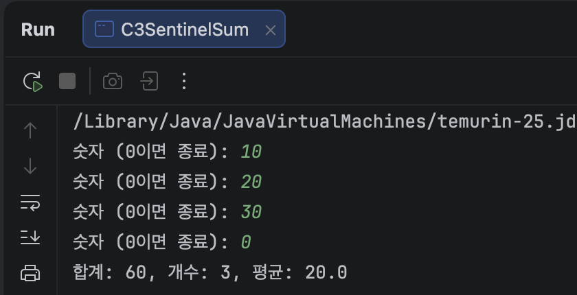   
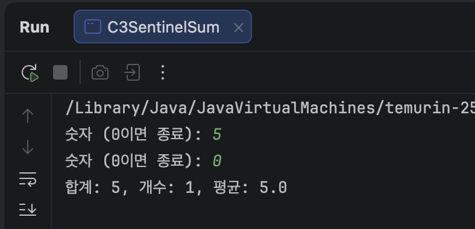   
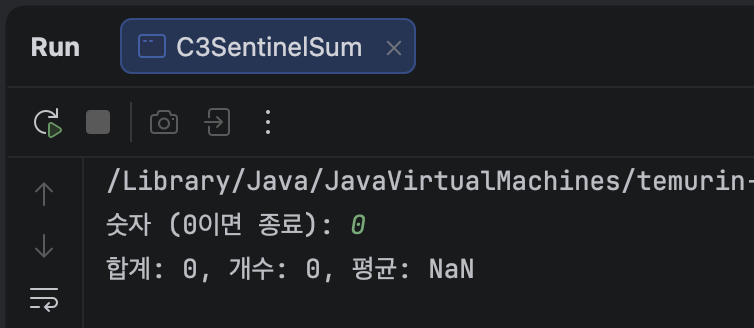   

**→ 바로 0 을 넣으면 뭐가 나오나요. 예상부터.**   
`int` 로 나눌 때랑 `double` 로 나눌 때가 다릅니다. 둘 다 돌려보세요.   
하나는 3-5 의 `10 / 0` 이고 하나는 `NaN` 이라는 게 나옵니다.   

#### - 예상
```
    숫자 (0이면 종료): 0
    합계: 0, 개수: 0, 평균: NaN   
```
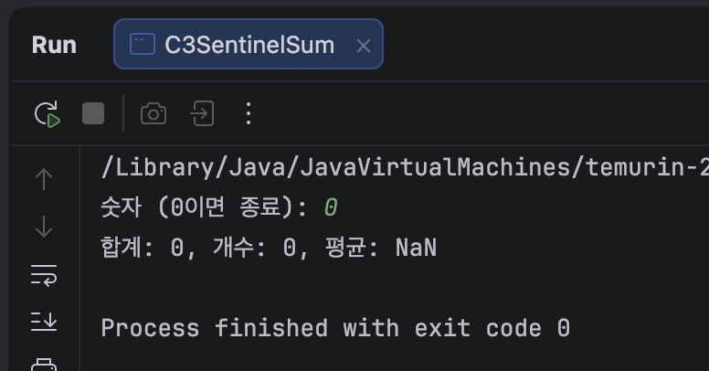

#### - 실행 결과
```
    // int                                                                                                                                                                                                   
    숫자 (0이면 종료): 0
    Exception in thread "main" java.lang.ArithmeticException: / by zero
        at week09.C3SentinelSum.main(C3SentinelSum.java:21)
    
    // double                                                                                                                                                                                                
    숫자 (0이면 종료): 0
    합계: 0, 개수: 0, 평균: NaN
```
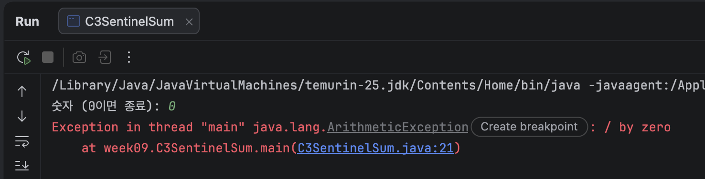   
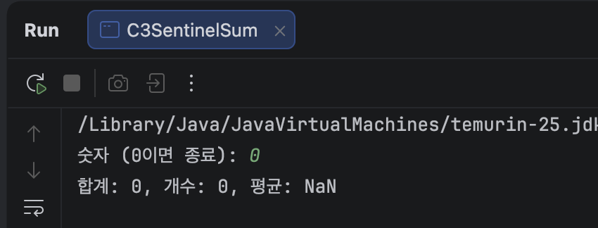   

**각각 6주차 표의 어디인지 적으세요.**   
`int`는 실행 오류(3-5 `10/0`과 같음), `double`은 평균: `NaN` 출력으로 오류 없이 틀린 답

**그리고 개수가 0 이면 "입력이 없습니다" 가 나오게 고치세요.**   
#### - 실행 결과
```
숫자 (0이면 종료): 0
입력이 없습니다
```
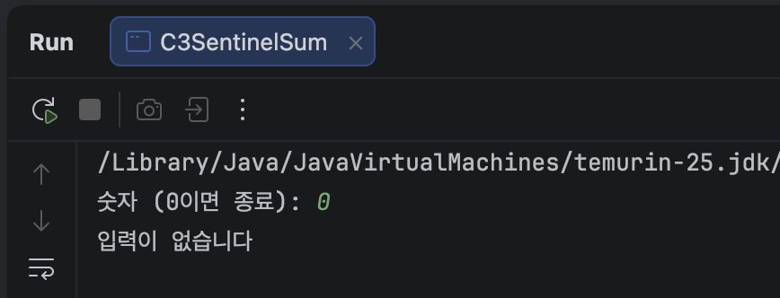   

**→ 이 0 을 "보초값" 이라고 합니다. 반복을 끝내는 신호로 쓰는 특별한 값이요.   
그런데 만약 진짜 0 을 데이터로 넣고 싶으면 어떡하죠.   
고치는 건 안 해도 됩니다. 어떻게 하면 될지 생각만 한 줄로.   
(힌트: 끝내는 신호를 다른 걸로 바꾸거나, 8주차 도전3 처럼 숫자 아닌 걸 신호로)**   
0 대신 다른 값을 신호로 쓰거나 8주차 처럼 숫자가 아닌 문자를 받아서 `hasNextInt()`를 사용하면 진짜 데이터로 받을 수 있음

**※ 커리큘럼 예제 그대로입니다. 베껴도 됩니다. 대신 왜 `while (true)` 안에서 `if (n == 0) break;` 가   
`sum += n;` 보다 위에 있어야 하는지 한 줄로. 순서를 바꿔서 돌려보면 보입니다.**   
0도 count에 포함되어 개수가 올라감   

#### - 실행 결과
```
// sum += n, count++ 를 break 보다 위로 옮긴 뒤 10 20 30 0 입력
숫자 (0이면 종료): 10
숫자 (0이면 종료): 20
숫자 (0이면 종료): 30
숫자 (0이면 종료): 0
합계: 60, 개수: 4, 평균: 15.0
```
문구는 sum 만 언급했지만 실제로 틀어지는 건 count 쪽임   
sum += 0 은 값이 안 바뀌어서 넘어가지만 `count++` 는 그대로 올라가서 개수: 4, 평균: 15.0 으로 틀리게 출력됨

***

## 힌트

`while` 은 조건 하나입니다.
```java
    while (조건식) {
        본문
    }
```
조건 `true` 면 본문, `false` 면 끝. 본문 끝나면 다시 조건.   
`for` 의 초기식은 `while` 위에, 증감식은 본문 안에 직접 씁니다. 그래서 빼먹기 쉽습니다.
```text
    for (int i = 1; i <= 5; i++) {          int i = 1;              ← 초기식
        본문                                while (i <= 5) {        ← 조건식
    }                                           본문
                                                i++;                ← 증감식 (내가 넣어야 함)
                                            }
```

`do-while` 은 한 번은 돕니다.
```java
    do {
        본문
    } while (조건식);      ← ; 꼭 있어야 함. for · while 과 다릅니다.
```
본문 먼저, 그 다음 조건. 조건이 처음부터 `false` 라도 한 번은 돕니다.   
"메뉴를 한 번은 보여줘야 할 때" 같은 자리에 씁니다.

`for` 와 `while` 고르기
```text
    몇 번 돌지 안다            for        10번, 배열 전체, 1 ~ n
    몇 번 돌지 모른다          while      0 누를 때까지, 조건 만족할 때까지, 자릿수
    한 번은 돌아야 한다        do-while   메뉴
```
서로 바꿔 쓸 수는 있습니다. 9-1 에서 직접 바꿔봅니다. 읽기 좋은 쪽을 고르면 됩니다.

`while` (`true`) + `break`
```java
    while (true) {
        ...
        if (끝낼 조건) break;
        ...
    }
```
조건이 항상 `true` 니까 `break` 가 유일한 출구입니다. `break` 가 없으면 무한 루프.   
`break` 는 "이 반복문 하나만" 나갑니다. `return` 은 "메서드 전체" 를 나갑니다. 도전1 에서 직접 봅니다.

자릿수 다루기
```text
    num % 10     마지막 자리          12345 % 10 = 5
    num / 10     마지막 자리 떼기     12345 / 10 = 1234
```
둘을 `while (num > 0)` 안에서 반복하면 자리가 하나씩 떨어집니다.   
9-2 · 9-4 둘 다 이 두 줄입니다.

무한 루프
```text
    while 은 for 보다 무한 루프에 더 자주 빠집니다. 증감식을 내가 직접 넣어야 하니까.
    i++ 가 if 안에 들어가 있으면 (도전2) 조건이 false 인 바퀴에서 i 가 안 바뀝니다.
    IntelliJ 빨간 네모(Stop). 터미널이면 Ctrl + C. 캡처는 멈춘 다음 한 장.
```

흔한 실수
```text
    i++ 빼먹음                   무한 루프. for 는 칸이 있어서 안 빼먹는데 while 은 빼먹음
    while (조건);                ; 하나로 본문이 비고 안 끝남. 8-5 보다 위험
    } while (조건)   ; 없음      컴파일 오류. 9-5 에서 직접 봄
    i++ 를 if 안에               조건 안 맞는 바퀴에서 i 가 멈춤
    보초값을 데이터로 더함        0 을 sum 에 더하진 않지만 count 는 올라감. 순서 확인
    0 으로 나누기                 개수 0 일 때 평균. int 는 터지고 double 은 NaN
```

## 제출 전 확인
- [x] 9-1 세 칸이 어디로 갔는지 주석으로 적었는가
- [x] 9-2 표를 돌리기 전에 채웠는가, 0 과 -123 결과를 적었는가
- [x] 9-3 ① ② 끝난 뒤 n 을 예상부터 적었는가
- [x] 9-4 1200 결과와 이유를 적었는가
- [x] 9-5 `do-while` `;` 지운 메시지, `while` `;` 붙인 결과를 적었는가
- [x] 도전1 `break` → `return` 차이를 돌려서 적었는가
- [x] 도전2 몇 개인지 예상을 먼저 적고 count 로 확인했는가
- [x] 도전3 바로 0 을 넣었을 때 `int` · `double` 둘 다 돌렸는가
- [x] 무한 루프 실험은 주석 + 바로 밑에 설명, 최종 코드는 끝나는 코드인가 (8-5 기억)
- [x] README 결과가 저장소 코드로 돌린 결과와 같은가
- [ ] 커밋 전 Ctrl + Alt + L
